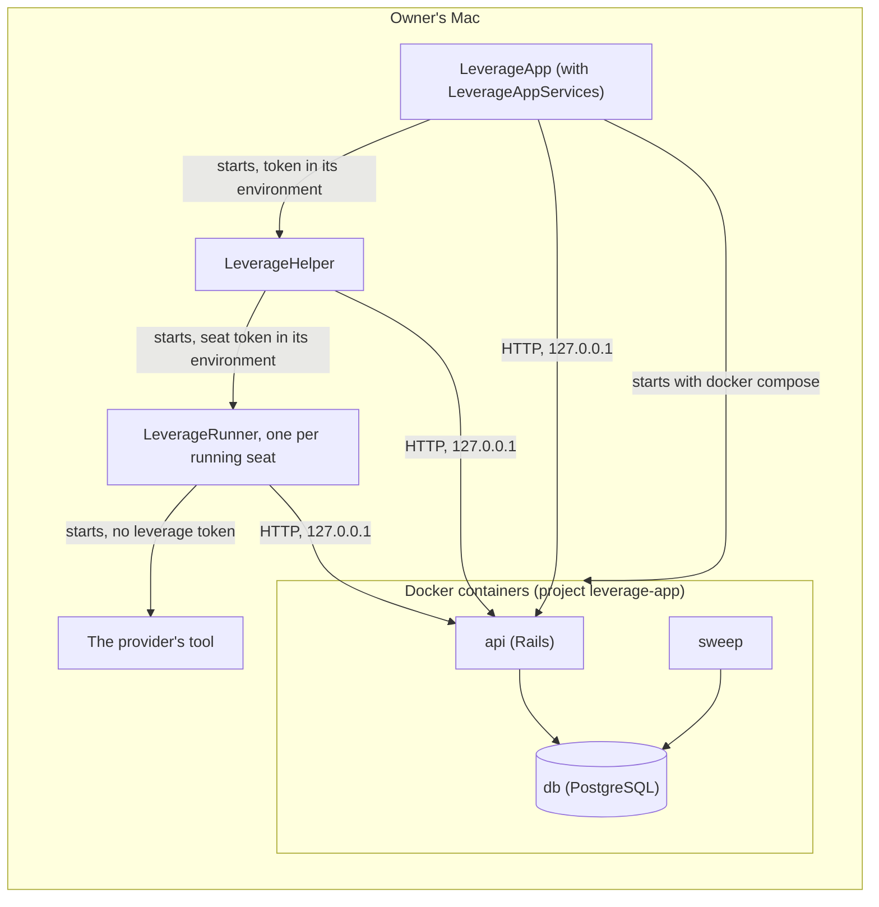

# Architecture

| | |
|---|---|
| **Status** | Rules in force; the contract recorded; the Core loop milestone built: the API's transition function, sign-in, the agent and helper calls, the helper, the reference runner and the Mac app, run on the owner's Mac |
| **Last updated** | 2026-11-19 |

This document describes how leverage is built: its components, how they
communicate, where data lives, and why the design is the way it is. It
describes the system **as it exists**, not as it is hoped to be. Planned work
belongs in the PRD or in issues.

The technology choices are recorded under
[Technology choices](#technology-choices), the components under
[Components](#components), the contract and what crosses each boundary under
[Data](#data), [Interfaces](#interfaces), [Providers' tools](#providers-tools)
and [Trust boundaries](#trust-boundaries). The [rules](#rules) are in force
now.

## Rules

These rules apply to every change, whoever or whatever writes it. Each rule
has a stable ID that is never reused. A pull request answers every **Active**
rule. A **Pending** rule is agreed but does not apply yet; its status names
the pull request that activates it. A **Retired** rule keeps its row and its
heading, so that its ID stays taken, and is no longer answered.

Pending rules are the one exception to this document describing only what
exists. They are recorded before they apply so that the first code is written
knowing them.

| ID | Rule | Status |
|----|------|--------|
| AR-001 | [Requirement-scoped pull requests](#ar-001-requirement-scoped-pull-requests) | Active |
| AR-002 | [One authoritative home per fact](#ar-002-one-authoritative-home-per-fact) | Active |
| AR-003 | [Decision record for hard-to-reverse choices](#ar-003-decision-record-for-hard-to-reverse-choices) | Active |
| AR-004 | [Declared, pinned, justified dependencies](#ar-004-declared-pinned-justified-dependencies) | Active |
| AR-005 | [Declared dependency direction](#ar-005-declared-dependency-direction) | Active |
| AR-006 | [One mechanism per cross-cutting concern](#ar-006-one-mechanism-per-cross-cutting-concern) | Active |
| AR-007 | [Tests that fail before the change, never silently weakened](#ar-007-tests-that-fail-before-the-change-never-silently-weakened) | Active |

A product source file is a source file outside `docs/`, `scripts/`,
`.github/`, and `.agents/`.

### How the rules are applied

1. **Read them before changing anything.** [AGENTS.md](../AGENTS.md) sends
   every agent here first.
2. **Answer them in the pull request.** The description has an "Architecture
   rules" section with one line per active rule, as a bulleted or numbered
   list:

   ```text
   - AR-001: Complies — implements #12
   - AR-003: N/A — no technology or boundary is chosen or changed
   - AR-004: Deviates — docs/adr/0002-short-title.md
   ```

   - `Complies` means the rule covers something in the change and the change
     follows it. Say in a few words what you checked.
   - `N/A` means nothing in the change is covered by the rule. Give the
     reason, in at least two words. AR-001 covers every pull request, so it
     is never `N/A`.
   - `Deviates` means the change breaks the rule and the maintainer has
     agreed to that. For AR-001, give the reason on the line. For any other
     rule the deviation stays in the repository after the merge, so name an
     ADR with status `Accepted` that records why; it may be added by the same
     pull request.

   An answer and its reason go on one line, or continue on indented lines
   directly below it. The section must be visible to a reader: answers inside
   an HTML comment or a code block do not count.
3. **A required check verifies the answers.** `scripts/check_rules.py` runs as
   the "Rules compliance" check. It fails while any active rule lacks an
   answer in one of those forms, and it runs the mechanical part of each
   rule, listed under the rule as "Checked automatically". It takes the rule
   list from the base branch as well as from the pull request, so a pull
   request cannot drop a rule to avoid answering it. A pull request that was
   already passing when a rule became active answers the rule at its next
   push or edit; the check does not rerun on its own. The check does not
   follow symbolic links in the files that decide its result, and it fails
   when git cannot tell it what the pull request changed.
4. **Review judges what the check cannot.**
   - The check proves that each rule was answered in the right form, not
     that the answer is true.
   - The check runs the pull request's own copy of the script and the
     workflow, so a pull request can change the check. When one changes the
     scripts, a workflow, the template, or this section, the check says so in
     a warning.
   - Every `Deviates` answer also produces a warning.
   - Nothing forces anyone to read the answers or the warnings. The ruleset
     on `main` requires no approving review, because a sole maintainer cannot
     approve their own pull request. The maintainer reads them before
     merging.

Dependabot pull requests are exempt from the "Architecture rules" section,
because Dependabot cannot fill it in. The checks on what the change adds still
run on them, and with no answers there is no `N/A` to soften one. A bot's
description is upstream release notes, so the IDs in it are not resolved.

To add, change, activate, or retire a rule, change this section in a pull
request. Activating a rule adds its line to the
[pull request template](../.github/PULL_REQUEST_TEMPLATE.md) and retiring one
removes it; the check fails if the template and the active rules differ.
The pull request that retires a rule still answers it, because the rule is
active on the base branch. A pull request that deletes a rule's row or heading
fails the check: set the rule's status to `Retired` instead.

### AR-001 Requirement-scoped pull requests

Every pull request has one purpose and names what it implements: requirement
IDs from the [PRD](PRD.md), an issue or pull request, or, when there is
neither, the purpose itself in a few words. It changes only what that
requires, plus the bookkeeping the project asks for (the changelog, `AUTHORS`,
and the documents the change affects). Unrequested features, speculative
configuration, and unrelated edits are left out. So is a layer of indirection
(an interface, base class, wrapper, or plug-in point) that the requirement
does not ask for and that has only one implementation behind it; a test
stand-in counts as a second. An unrelated problem is reported as an issue, or
through [SECURITY.md](../SECURITY.md) if it is security-sensitive. This rule
does not replace the [scope policy](../MAINTENANCE.md#scope): a feature still
needs a requirement in the PRD first.

- **Checked automatically:** the answer is `Complies` followed by a
  requirement ID, an issue or pull request number, or a purpose of at least
  two words; or it is `Deviates` followed by a reason.
- **Left to review:** whether the requirement or number cited is real and is
  the reason for the change (a placeholder row in the PRD and a number that
  does not exist both pass the check), and whether the change contains only
  what was required.

### AR-002 One authoritative home per fact

Each of these facts has one home: a requirement in the [PRD](PRD.md), an
architecture decision in its [ADR](#architecture-decision-records), an
architecture rule (`AR-…`) in this section, and an interface definition in
this document. Other files and pull requests refer to them by ID or link and
do not restate them. Naming a rule's subject next to its ID is a reference;
repeating its conditions is a restatement. A generated file whose source is
in the repository is changed only by changing that source and regenerating
it.

- **Checked automatically:** every well-formed `FR-`, `NFR-`, and `AR-` ID
  (prefix, hyphen, three digits) used in a pull request description or in a
  Markdown file under `docs/` is defined in its home, and every `AR-` ID used
  in any Markdown file is defined here. A description may also name an ID
  that the pull request removes. Text inside HTML comments and fenced code
  blocks is not read. `docs/research/` is left out because it is an archive,
  and Markdown files outside `docs/` use requirement IDs only as format
  examples.
- **Left to review:** whether prose restates a fact that already has a home.
  A generated file is compared with a fresh run only where CI runs its
  generator with `--check`; today that is
  `mac/Sources/LeverageKit/Generated/Contract.swift`, from
  `scripts/generate_swift_contract.py`.

### AR-003 Decision record for hard-to-reverse choices

A pull request that makes or changes a hard-to-reverse choice adds an ADR in
`docs/adr/` with status `Accepted`; merging the pull request is the
maintainer's acceptance. Such choices include a language, runtime, framework,
datastore, external service, and component boundary. A change that
contradicts an accepted ADR supersedes that ADR in the same pull request; an
author who does not have the maintainer's agreement to do that stops and asks
first. The format is under
[Architecture decision records](#architecture-decision-records).

- **Checked automatically:**
  - Every file under `docs/adr/` is an ADR with a valid name, a unique
    number, and a valid status, and a superseded ADR names a successor that
    exists.
  - A pull request that adds the repository's first dependency manifest of a
    kind (`package.json`, `go.mod`, `pyproject.toml`, a `Dockerfile`, and the
    like) adds or changes an ADR.
  - A pull request that changes the [Components](#components) or
    [Technology choices](#technology-choices) section adds or changes an ADR.
    Answering `N/A` turns this one failure into a warning, for a change of
    wording only.
- **Left to review:** whether a choice is hard to reverse, whether the ADR
  says what was decided and has the right status, and whether a change
  contradicts an accepted ADR. A language introduced without a manifest is
  not detected.

### AR-004 Declared, pinned, justified dependencies

A pull request that adds a direct dependency (a library, tool, GitHub Action,
or external service) names each one in its description with its license, its
pinned version or commit SHA, and why existing code or the standard library
does not suffice. A library or tool must exist in its ecosystem's official
registry, and its license must be compatible with the MIT License.

- **Checked automatically:** every `uses:` in a workflow under
  `.github/workflows/` or in an action definition (`action.yml`) is written
  on one line and pinned to a full commit SHA, or to a digest for a container
  image. A third-party action or container image that the pull request adds
  is named in the description, and the answer is then not `N/A`.
- **Left to review:** the license, the justification, whether the package is
  the real one, and whether a changed SHA is the release it claims to be.
  The library manifests (`api/Gemfile`, `api/Gemfile.lock`,
  `mac/Package.swift`) and the image and package lines in `api/Dockerfile`
  and `compose.yaml` are not checked automatically: a reviewer compares them
  with the description.

### AR-005 Declared dependency direction

Code imports only along the dependency directions listed under
[Components](#components). A pull request that needs a new direction changes
that list, with an ADR, in the same pull request.

- **Checked automatically:** `scripts/check_imports.py`, the "Import
  directions" job in CI, reads the
  [allowed dependency directions](#allowed-dependency-directions) and fails
  when a Swift file imports a code unit its own unit may not import, when a
  Ruby file loads a file outside its unit's folder, or when a Swift or Ruby
  file outside `docs/`, `scripts/`, `.github/`, and `.agents/` is in no listed
  unit (`mac/Package.swift`, the package manifest, excepted). Because the
  list is in the Components section, changing it also needs an ADR under
  rule AR-003.
- **Left to review:** a dependency the check cannot see: a file loaded
  through a computed path, a target dependency in `mac/Package.swift` that
  no source file imports, and a call between components that is not an
  import (the Mac side reaches the API only over HTTP).

### AR-006 One mechanism per cross-cutting concern

Each cross-cutting concern (errors, logging, configuration, persistence,
shared helpers) has one designated mechanism, named in this document. A pull
request uses it and does not add a second mechanism or a duplicate of
something it already provides.

The mechanisms are listed under
[Cross-cutting mechanisms](#cross-cutting-mechanisms).

- **Checked automatically:** nothing.
- **Left to review:** whether a change uses the listed mechanism, and
  whether it adds a second one. A change that needs a new mechanism, or a
  first one where the list says "none yet", changes the list in the same
  pull request.

### AR-007 Tests that fail before the change, never silently weakened

A pull request that changes behavior adds or updates at least one test that
fails on the base branch and passes with the change. It does not delete,
skip, or loosen an existing assertion unless its description names the
assertion and the reason.

- **Checked automatically:** for the API and the Mac side only. Their
  product source is any file under `api/` or `mac/` that is not Markdown and
  not in a test folder. A test file is a `.rb` or `.swift` file under
  `api/test/` (for `api/`) or `mac/Tests/` (for `mac/`), and it counts only
  for its own component and only if the lines the pull request adds to it
  include an assertion.
  - A pull request that adds, changes, or deletes product source in a
    component, and adds no assertion to a test file of that component,
    fails. Answering `N/A` with a reason turns the failure into a warning,
    for a change with no behavior in it; a `Deviates` answer with its
    accepted ADR passes. A bot's pull request is held to this too; a
    maintainer answers for it by adding an AR-007 line to its description.
  - A pull request that removes or changes an assertion line or a test
    definition line (`test "..."`, `def test_`, `@Test`, `func test`) in an
    existing test file, deletes a test file that has assertions, or adds a
    skip to an existing test file gets a warning that names the file and the
    lines. The description must name each one and the reason.
- **Left to review:** product source outside `api/` and `mac/` (a Swift or
  Ruby file there also fails the AR-005 check until its unit is listed),
  whether the new test fails on the base branch, whether it tests the
  behavior that changed, whether a warned line really weakens the test,
  whether the description names it, and other ways to disable a test that
  the check does not recognize.

## Engineering practices

These are how the work is done. The [rules](#rules) say what a pull request
must satisfy; where a practice is also a rule, the rule is the authority.

- **Test-driven development.** Write the test first, see it fail, make it
  pass, then tidy with the tests green. Rule AR-007 is the requirement. To
  show it, commit the test before the code, or quote the test's failure on
  the base branch under "How it was verified".
- **The contract first.** What two parts share (tables, event types, the
  fixed lists, the interface schema) is written and reviewed before either
  part is built, and it lives in one place. Parts are built against it, with
  stand-ins where the other side does not exist yet.
- **Small steps that leave `main` working.** Every merge leaves the checks
  green and the product runnable; how work is split into pull requests is
  [AR-001](#ar-001-requirement-scoped-pull-requests).
- **Tests at the level of the behavior.** Unit tests for rules that are pure
  logic, tests against the interface schema for every call, and a run of the
  whole task loop for what crosses parts. A provider's tool is replaced by a
  stand-in in automated tests; nothing in CI calls a provider.
- **No secret in the repository, a log, an event, a fixture or a
  screenshot.** Tests use made-up values. Records name a credential by its
  id.
- **An adversarial review before merge in a delegated run.** In a run
  delegated under [CONTRIBUTING.md](../CONTRIBUTING.md#ai-assisted-contributions),
  a reviewer who did not write the change tries to break it, and its
  findings are fixed or answered in the pull request.
- **Documents in step.** A change that alters behavior, structure,
  configuration or deployment updates the matching document, and
  [IMPLEMENTATION.md](IMPLEMENTATION.md), in the same pull request.

## System overview



The Core loop runs on the owner's Mac. The Mac app starts the server's three
containers through Docker Desktop ([ADR 0004](adr/0004-one-app-bundle-for-the-first-run.md)):
the API, the sweep that applies due timers, and PostgreSQL. Once the owner
signs in, the app starts the helper, which polls the server for its
requests: it adds and verifies logins, installs a provider's tool, and
starts and stops a `LeverageRunner` for each seat the app runs. A runner
claims tasks or reviews over the agent interface and drives the provider's
tool for each criterion or review; the tool never calls leverage. Every
change goes through the API's transition function, which appends the event
log in the same transaction. A seat that connects on its own calls the same
agent interface with its own token.

## Components

Seven product units exist: the API and six Swift ones. The roles
[ADR 0001](adr/0001-rails-api-postgresql-and-a-mac-client.md) gives them,
and the units [ADR 0005](adr/0005-code-units-of-the-core-loop.md) adds, are
built as far as the Core loop milestone; each entry says what the code does
today.

### API

- **Responsibility:** the server of a workspace. It serves the operations
  listed in `Leverage::Http::RouteTable` (see [Interfaces](#interfaces)):
  the owner's sign-in and commands, the agent calls of a builder and a
  reviewer, and the helper's calls. Every change is a command through
  `Leverage::Transitions.apply`, the one writer: it takes the workspace's
  lock, finds a stored outcome by idempotency key, applies due timers,
  picks a refusal by the registry's precedence, asks
  `Leverage::Gating` (in this milestone `Gating::NoRules`, which allows
  everything), runs the command's entry, appends its events and moves the
  steps in the same transaction, and stores the outcome. Reads are
  `Leverage::Reads::*`, which write nothing; the owner's reads run in one
  repeatable-read snapshot and carry the log position they saw.
- **Owns:** the PostgreSQL database and the HTTP interface under `/v1`.
- **Depends on:** PostgreSQL, and the gems in `api/Gemfile`. It depends on
  no other component.
- **Code:** `api/`, a Rails application in API mode; tests in `api/test/`.
  `api/lib/leverage/` holds the transition function (`transitions.rb`,
  `transitions/`, one entry per command in `transitions/entries/`), its
  parts (`event_log.rb`, `workspace_lock.rb`, `idempotency.rb`,
  `steps.rb`, `holds.rb`, `leases.rb`, `timers.rb`, `eligibility.rb`,
  `briefing.rb`, `tokens.rb`, `seat_runs.rb`), the sweep (`sweep.rb`,
  `api/bin/sweep`), the reads, `Leverage::Replay` and `Leverage::LogAudit`
  (run by `bin/rails leverage:verify_log`), and milestone 1's
  `Leverage::Contract` and `Leverage::Gating`. The role files a briefing
  carries are `api/config/role_files/`, and the landing prompt's template
  is `api/config/landing_prompt.md.erb`. It runs in the `api` and `sweep`
  containers that `compose.yaml` describes.

### Shared Swift library (LeverageKit)

- **Responsibility:** what the Mac side's programs share: the clients of
  the three interfaces (`OwnerClient`, `AgentClient`, `HelperClient`
  behind the protocols `OwnerAPI`, `AgentAPI`, `HelperAPI`), sent through
  `HTTPTransport`; the contract's models; the contract's fixed lists and
  operations in `Generated/Contract.swift`, written by
  `scripts/generate_swift_contract.py`; `Subprocess`, `Log` and
  `Redaction`; `ProviderCatalog`; `EnvironmentKeys`; and the protocols the
  app's screens depend on (`AppRuntime`).
- **Owns:** every HTTP call from the Mac side to the API, and the decoding
  of the answers.
- **Depends on:** Foundation (`FoundationNetworking` where it exists), the C
  library, and the API over HTTP.
- **Code:** `mac/Sources/LeverageKit/`; tests in `mac/Tests/LeverageKitTests/`.

### Reference runner (LeverageRunner)

- **Responsibility:** one seat's work, as a process the helper starts. It
  long-polls `GET /v1/next`, claims a task or a review, acknowledges the
  briefing, heartbeats the lease, runs the provider's tool once per open
  criterion (a builder) or once per review (a reviewer), reads the marker
  lines `LEVERAGE-EVIDENCE`, `LEVERAGE-CANNOT`, `LEVERAGE-CRITERION` and
  `LEVERAGE-NOTES` from the answer, and sends the calls. One driver per
  provider gives the tool's arguments (see
  [Providers' tools](#providers-tools)). `LeverageRunner probe` runs one
  test prompt, for the helper's `test_prompt` check. On a stop signal it
  ends the tool's process group, gives back what it holds and exits 0.
- **Owns:** nothing stored. It makes `<work root>/<task id>/` when a task
  names no folder.
- **Depends on:** LeverageKit.
- **Code:** `mac/Sources/LeverageRunner/`; tests in
  `mac/Tests/LeverageRunnerTests/`.

### Mac helper (LeverageHelper)

- **Responsibility:** a command-line program the app starts with the
  helper's token. It long-polls `GET /v1/helper/next` and does one request
  at a time: the three login checks of Add credential and Verify (tool
  installed, signed in, test prompt), with progress per check; installing
  a provider's tool from its catalog source after the owner confirmed;
  starting a seat's run (seat-token pickup, then `LeverageRunner` with the
  token in its environment) and stopping it. It never adopts an existing
  account folder: Add always starts from a new, empty one. It stops its
  runs and exits when its token answers `401` (exit 3) or when the app that
  started it is gone (`ParentWatch`, in LeverageKit). A runner watches the
  helper the same way and stops as on SIGTERM when the helper is gone.
  How long each part of a stop is given is `StopTimings`, in LeverageKit:
  the app waits 16 seconds for the helper, the helper 10 for a runner, and
  a runner 4 to give back what its seat holds.
- **Owns:** the account folders, the tools leverage installed, and the
  runs' logs, under the support folder (see [Data](#data)).
- **Depends on:** LeverageKit and Foundation.
- **Code:** `mac/Sources/LeverageHelper/`; tests in
  `mac/Tests/LeverageHelperTests/`.

### Mac app services (LeverageAppServices)

- **Responsibility:** what the app does outside its window, without
  SwiftUI: `DockerLocator` (the `docker` program in four known folders),
  `ServerFiles` (the server folder), `ServerSupervisor` (Docker Desktop,
  `docker compose up -d`, the wait for health), `HelperSupervisor` (the
  helper's token and process, its restarts, its stop), `AppLock` (one app
  per support folder), `SessionStore` (`KeychainSessionStore` and
  `MemorySessionStore`), and `ProcessRunner` for docker's commands.
- **Owns:** the server folder and the owner's session in the Keychain.
- **Depends on:** LeverageKit and Foundation.
- **Code:** `mac/Sources/LeverageAppServices/`; tests in
  `mac/Tests/LeverageAppServicesTests/`.

### Mac app (LeverageApp)

- **Responsibility:** the owner's window. It starts the server and, after
  sign-in, the helper; creates the owner's sign-in on a new installation,
  signs in and out; and shows the board, the task page with its log, the
  Add task form, the Agent roster with Connect (and the landing prompt of
  a seat that connects on its own) and the Credentials list with Add
  credential. Every owner-facing sentence is a case of a copy catalog,
  checked against the PRD's banned terms by `CopyTests`. `Live.swift`
  builds the real services (`LiveSettings`, the support folder's lock);
  the image tag comes from the bundle's `LeverageAPIImageTag`.
- **Owns:** nothing stored itself; the services above keep the session.
- **Depends on:** LeverageKit, LeverageAppServices and SwiftUI.
- **Code:** `mac/Sources/LeverageApp/` (`Shell/`, `SignIn/`, `Board/`,
  `AddTask/`, `TaskPage/`, `Agents/`, `Credentials/`, `Design/`); tests in
  `mac/Tests/LeverageAppTests/`. `scripts/build_app.sh` assembles
  `dist/Leverage.app` from it, the helper, the runner and
  `mac/Packaging/`.

### Test units

`LeverageTestSupport` holds what the Swift tests share: the stand-in tool
locator, temporary folders, `StubURLProtocol` and in-memory fakes of the
three API protocols and of the app's runtime. `LeverageEndToEndTests` runs
the built helper and runner against the real API (`scripts/e2e_core_loop.sh`).
`mac/Tests/StandIns/` holds the stand-in tools (`claude`, `codex`, `agy`,
`grok`, an installer and an archive) in Python and shell; it is not a code
unit.

### Allowed dependency directions

Code imports only along these directions (rule AR-005). Each code unit is a
Swift target or the Rails application; "may import" lists the other code
units it may import, and nothing else of ours. Platform modules and
libraries are not code units: rule AR-004 covers them. Across components,
the Mac side reaches the API only over HTTP, through LeverageKit, and the
API calls nothing on the Mac side.

The runner and the helper never import each other: the helper starts the
runner as a process. The app imports neither: it reaches the helper only
through the server and by starting its process. The units and their
directions are recorded in
[ADR 0005](adr/0005-code-units-of-the-core-loop.md).

| Code unit | Folder | May import |
|---|---|---|
| `LeverageKit` | `mac/Sources/LeverageKit/` | nothing |
| `LeverageRunner` | `mac/Sources/LeverageRunner/` | `LeverageKit` |
| `LeverageHelper` | `mac/Sources/LeverageHelper/` | `LeverageKit` |
| `LeverageAppServices` | `mac/Sources/LeverageAppServices/` | `LeverageKit` |
| `LeverageApp` | `mac/Sources/LeverageApp/` | `LeverageKit`, `LeverageAppServices` |
| `LeverageTestSupport` | `mac/Tests/LeverageTestSupport/` | `LeverageKit` |
| `LeverageKitTests` | `mac/Tests/LeverageKitTests/` | `LeverageKit`, `LeverageTestSupport` |
| `LeverageRunnerTests` | `mac/Tests/LeverageRunnerTests/` | `LeverageKit`, `LeverageRunner`, `LeverageTestSupport` |
| `LeverageHelperTests` | `mac/Tests/LeverageHelperTests/` | `LeverageKit`, `LeverageHelper`, `LeverageTestSupport` |
| `LeverageAppServicesTests` | `mac/Tests/LeverageAppServicesTests/` | `LeverageKit`, `LeverageAppServices`, `LeverageTestSupport` |
| `LeverageAppTests` | `mac/Tests/LeverageAppTests/` | `LeverageKit`, `LeverageApp`, `LeverageTestSupport` |
| `LeverageEndToEndTests` | `mac/Tests/LeverageEndToEndTests/` | `LeverageKit`, `LeverageTestSupport` |
| `api` | `api/` | nothing |

`python3 scripts/check_imports.py` checks the code against this table.

## Cross-cutting mechanisms

Each concern has one mechanism on each side (rule AR-006). "None yet" means
the first change that needs one chooses it and adds it here.

| Concern | API (`api/`) | Mac side (`mac/`) |
|---|---|---|
| Errors | `ApplicationController` answers every error with the contract's transport error body, `{"error":{"code","message"}}`, and one of five codes: `400 malformed`, `401 unauthenticated`, `404 not_found`, `422 invalid` or `key_reused`; errors raised before a controller runs go through `ApplicationController.exceptions_app`, and `JsonBodiesOnly` (`api/lib/middleware/`) answers a body not sent as JSON in the same shape. A 5xx answer hides the message, which is logged. A command that is refused is not an error: it answers `409` with the outcome body. | `LeverageClientError` in LeverageKit for what the clients raise (a transport error with its code, a refusal, an unexpected status or body); a network failure passes through as the `URLError` that `URLSession` threw. |
| Logging | `Rails.logger`; in production to standard output, tagged with the request ID. Each command adds one line, `leverage.command`, with the command, the caller, the key, the outcome, the refusal code and three timings (`Leverage::CommandLog`); never a header or a body. Logged parameters are filtered for anything shaped like a token. | `Log` in LeverageKit: one line per message to standard error, `<UTC time> <component> <level>: <message>`, after `Redaction` removes tokens (keeping their prefix), bearer values and email addresses. The app sends the helper's output to `<support folder>/logs/helper.log`, and the helper each run's to `logs/seat-<id>.log`; each is replaced once it passes 5 MB. |
| Configuration | Environment variables, set from `.env` through `compose.yaml` and read under `api/config/`. | The process environment, every name in `EnvironmentKeys` in LeverageKit (`LEVERAGE_API_URL` and the rest; [DEPLOY.md](DEPLOY.md) lists them). The bundle's image tag is the `Info.plist` key `LeverageAPIImageTag`. |
| Persistence | Active Record on PostgreSQL. | The owner's session token in the login Keychain (`KeychainSessionStore`, one item); everything else in files under the support folder (see [Data](#data)). No token is ever written to a file. |
| Child processes | None. | `Subprocess` in LeverageKit: an absolute program path, an environment built from an allow-list and never the parent's, standard input `/dev/null`, the child in a process group of its own, both outputs read while it runs, and a time limit or stop that sends the group `SIGTERM` and then `SIGKILL`. A provider's tool gets `PATH`, `HOME`, `TMPDIR`, `LANG`, its account-folder variable and, for Claude, `USER` (`ProviderCatalog.toolEnvironment`); the runner gets the helper's `HOME`, `TMPDIR`, `LANG` and `USER`, `PATH=/usr/bin:/bin`, its seat token and the run's inputs; the helper gets `HOME`, `PATH`, `TMPDIR`, `LANG`, `USER`, its token, the API's address and the support folder; docker gets only `HOME` and `PATH`. |
| Shared helpers | `Leverage::Contract` (`api/lib/leverage/contract.rb`) reads `api/contract/` and validates a payload against its schema with `json_schemer`. | LeverageKit. |

## Data

- **Where.** PostgreSQL, in the `db` container, is the only store of the
  workspace. The PRD's [Data model](PRD.md#data-model) is the requirement;
  `api/db/structure.sql` is the schema, built by the migrations in
  `api/db/migrate/`. It has the 26 tables the Data model names plus
  `sessions`, `helper_requests` and `briefing_acknowledgements` (owner
  sign-in, the helper's requests and briefing acknowledgements), 29 in all,
  and each but `workspaces` has a `workspace_id` with a foreign key. The
  Core loop added `helper_requests.params` and `helper_requests.progress`
  (the non-secret inputs of a request, and per-check progress) and
  `seats.wanted_running`. CI migrates from zero, with `structure.sql` moved
  away so the migrations run, and fails when the result differs from the
  committed file. From the Core loop on, migrations only go forward.
- **Who writes.** Every change goes through `Leverage::Transitions`; the
  sweep also writes its own `sweep_runs` rows. Only `Leverage::EventLog`
  inserts into `events`, and no controller or read writes; a static test
  holds both. The schema itself refuses what the PRD forbids:
  - `events` and `rule_versions` are append-only: a trigger refuses
    `UPDATE`, `DELETE` and `TRUNCATE` for every role. The server and the
    sweep log in as `leverage_api`, a member of `leverage_app`, which has
    no right to change either even with a trigger switched off
    ([ADR 0007](adr/0007-sweep-service-and-database-login-role.md)).
  - A task's state changes only in a transaction that writes an event for
    that task in its workspace: two deferred constraint triggers on
    `tasks` check at commit for an `events` row whose `xact_id` (set by
    default to `pg_current_xact_id()`) is the transaction's own.
  - `rule_checks (rule_id, rule_version_id)` and `rules (id,
    current_version)` are composite foreign keys, so a check's version and
    a rule's current version belong to that rule.
  - A seat reviews at most one review at a time: the unique index on
    `reviews.reviewer_seat_id` counts only reviews with no verdict.
  - The `leverage_app` role (`NOLOGIN`, kept by the `db:grants` task after
    every task that builds or changes the schema) has `SELECT, INSERT` on
    `events` and `rule_versions`, `SELECT, INSERT, UPDATE, DELETE` on every
    other table, and no `TRUNCATE`. Migrations, tests and other commands
    use the database's owner role.
- **What is never stored.** No column holds a token or a password in the
  clear: the only such names are `token_hash` (`sessions`, `helpers`,
  `seats`, a SHA-256 hex digest) and `users.password_digest` (bcrypt). A
  check constraint refuses any key named `token` or ending in `_token`, in
  any letter case and at any depth, in `commands.result`,
  `commands.refusal`, `helper_requests.result`, `helper_requests.params`
  and `helper_requests.progress`; the last two also refuse a key named
  `name`. A count named `tokens` is allowed. A credential is a row with a
  name, a kind and a state; no login, sign-in token, settings folder or
  keychain reference has a column.
- **How long.** The sweep deletes `commands` rows (the idempotency keys and
  stored outcomes) and `sweep_runs` rows older than 7 days. Nothing else is
  deleted; the log is kept for good. Nothing backs the database up yet
  ([DEPLOY.md](DEPLOY.md) says where it is and what destroys it).
- **Values.** Closed values are plain `text` columns, checked by the
  application against `api/contract/registry.json`; there is no PostgreSQL
  enum type. Durations that are settings are integer seconds.
- **On the Mac.** Under the support folder, `~/Library/Application
  Support/leverage` (or `LEVERAGE_SUPPORT_DIR`): `server/` (the compose
  file and the `.env` with the database passwords and `SECRET_KEY_BASE`,
  folder 0700, files 0600), `accounts/<credential id>/` (a Claude or Codex
  login's own settings folder, made new by Add and removed when the add
  fails), `tools/<provider>/` (a tool leverage unpacked),
  `work/<task id>/` (a task's folder when it names none), `logs/`
  (`helper.log` and one `seat-<id>.log` per run) and `app.lock`. A
  provider's own sign-in lives in that folder or, for a provider with one
  sign-in for the Mac, where the tool keeps it; leverage never reads it.

## Interfaces

`api/contract/` is the definition of every interface between two parts of
leverage; [its README](../api/contract/README.md) says how each file is
written and read. This section is the pointer AR-002 asks for, and states
the stability rules.

| Interface | Defined in |
| --- | --- |
| The agent, owner and helper HTTP interfaces | `api/contract/openapi.json` (OpenAPI 3.1, tags `agent`, `owner`, `helper`) |
| Which operations are served | `Leverage::Http::RouteTable` (`api/lib/leverage/http/route_table.rb`); `config/routes.rb` draws each from the registry's method and path |
| Events: types and payloads | `api/contract/registry.json` and `api/contract/payloads/<type>.v<n>.json` |
| The fixed lists every part uses | `api/contract/registry.json`; on the Mac side, `mac/Sources/LeverageKit/Generated/Contract.swift`, generated from it |
| States, commands, steps, hooks, jobs, roles, timers, Needs you | `api/contract/*.json`, one file each |
| The transition function and rule gating, in process | `Leverage::Gating` (`api/lib/leverage/gating.rb`) and the conformance suite `api/test/support/gating_conformance.rb` |
| Credential readers | `api/contract/readers.json` |
| Expected behavior, end to end | `api/contract/traces/` (ten traces; 09 and 10 are the Core loop's, with no rules) |
| The provider's tool | Its command line, driven by the runner (see [Providers' tools](#providers-tools)) |

The served operations are the Core loop's: 16 agent calls, the owner's
sign-in, reads and commands, the helper's calls, and `GET /v1/health`. Every
other operation of the contract answers `404`. The Core loop added six
operations to the contract: `get_setup_state` and `create_owner` (the
first sign-in), `sign_out_owner`, `get_helper_request` (one helper
request's state and progress, with a long poll), `report_request_progress`
(the helper's per-check progress) and `get_landing_prompt` (the text the
owner pastes into a seat that connects on its own).

- **Commands.** Every call that changes something is a `POST` that carries
  an `Idempotency-Key` header and answers one outcome body: 200 completed,
  202 pending, 409 refused with a code from the registry's `refusals`. A
  repeat of the key answers the stored outcome and writes nothing.
- **Events** are versioned. A released payload version is never edited: a
  change adds a new version, the server writes the newest, every reader
  handles every listed version, and old events are never rewritten.
- **Lists.** A value of a list the PRD tables changes the PRD first.
  `scripts/check_registry.py` and `scripts/check_contract_tables.py` fail
  in CI when the PRD and the contract differ, and
  `scripts/generate_swift_contract.py --check` when the Swift copy is
  stale.
- **Provisional parts** are marked: owner reads with `x-provisional: true`
  in `openapi.json`, and readers with `provisional: true` in
  `readers.json`. They may change without a new version until they are
  marked final.

## Providers' tools

The runner and the helper drive four login providers' tools from one table,
`ProviderCatalog` in LeverageKit and one driver per provider in
`LeverageRunner`. Each fact carries how far it is proven: `probe` ran on the
owner's Mac on 2026-11-19 under the allow-listed environment; `help` is in
the tool's own `--help`, never run; `documented` is in the vendor's
documentation, never run; `unverified` is none of these. Nothing below
`probe` is called proven.

| Provider (tool) | Account | Status and sign-in | Installer | Reviewer run | Builder run differs by |
| --- | --- | --- | --- | --- | --- |
| Claude (Claude Code, `claude`) | `CLAUDE_CONFIG_DIR` (`probe`); needs `USER` (`probe`) | `claude auth status`, field `loggedIn` (`probe`); `claude auth login` (`help`) | `https://claude.ai/install.sh` with `/bin/bash` (`documented`) | `claude -p <prompt> --output-format json --no-session-persistence --permission-mode dontAsk` (`probe`), with `--strict-mcp-config --setting-sources user` (`help`) | `--permission-mode acceptEdits`, `--model`, `--effort` (`help`) |
| Codex (Codex, `codex`) | `CODEX_HOME` (`probe`) | `codex login status`, exit code (`probe`); `codex login` (`help`) | `https://chatgpt.com/codex/install.sh` with `/bin/sh` (`documented`) | `codex exec <prompt> --json --sandbox read-only --skip-git-repo-check --ephemeral -C <dir> -o <file>` (`probe`) | `--sandbox workspace-write`, `-m` (`help`); no effort is passed, and Connect asks for none |
| Gemini (Antigravity, `agy`) | One sign-in for the Mac (`help`; the PRD states it) | No status or sign-in command (`help`): the test prompt is repeated | `https://antigravity.google/cli/install.sh` with `/bin/bash` (`documented`) | Not offered: `agy -p <prompt> --output-format json --print-timeout <n>s --mode plan` answered with a plan, not the word asked for (`probe`), so the runner refuses a Gemini reviewer and Connect does not list a Gemini login for one | Builder: the same without `--mode plan`, with `--mode accept-edits`, `--model`, `--effort` (`help`) |
| Grok (Grok Build, `grok`) | Treated as one sign-in for the Mac (`unverified`) | `grok models`, signed out when it says "You are not authenticated." (`probe`); `grok login --oauth` (`help`) | None: no documented source was reachable (`unverified`) | `grok -p <prompt> --cwd <dir> --permission-mode plan` (`help`) | `--permission-mode acceptEdits`, `-m` (`help`); no effort is passed, and Connect asks for none |

The test prompt of Claude, Codex and Antigravity answered "ready" under the
allow-listed environment (`probe`); Grok was signed out, so no prompt ran.
No installer and no sign-in command has been run by an agent. The tool's
standard input is always `/dev/null`, it runs in the task's folder under a
time limit, and no run gets a flag that skips permissions or sandboxing.
An installer is downloaded only over HTTPS from a host its catalog entry
lists.

## Trust boundaries

The Core loop is the first code that crosses the line between the Mac and
the server. Security review starts here; see [SECURITY.md](../SECURITY.md).

- **Network.** `compose.yaml` publishes the API on `127.0.0.1` only, and
  every Mac-side program calls it over plain HTTP. Nothing else on the
  network can reach it. In production the API answers only a request
  addressed to `127.0.0.1`, `localhost`, `[::1]` or `api`
  (`config.hosts`), so a web page in the owner's browser that rebinds its
  own name to the loopback address is refused `403`. Before the server leaves the Mac the transport
  must become HTTPS ([ADR 0006](adr/0006-owner-sign-in-and-tokens.md));
  `Configuration` already accepts an `https` address.
- **Callers and their tokens.** Three callers reach the server, each with
  its own bearer token (`lvo_` owner session, `lvh_` helper, `lvs_` seat):
  32 random bytes, shown once, stored only as a SHA-256 digest.
  `x-leverage-caller` on each operation and `roles.json` say which caller
  may run it, and a token of another kind answers `401`.
  - The owner's session is made by sign-in or setup, kept in the owner's
    login Keychain, and ended by sign-out. It has no expiry.
  - The helper's token is made by the app's `issue_helper_token` each time
    the app starts the helper, lives only in the helper's environment, and
    ends when the next one is issued.
  - A seat's token is made by the helper's seat-token pickup for a seat
    the app runs, and lives only in its runner's environment; it ends at
    the next pickup, when the run is reported stopped, and when the seat is
    removed. A seat that connects on its own gets its token once in the
    Connect sheet; Remove ends it.
- **The setup call.** `POST /v1/owner/setup` needs no token and creates the
  one owner. It answers `404` once an owner exists; until then any program
  on the Mac that can reach the loopback address could call it.
- **Untrusted input.** Everything a seat sends (contract text, notes,
  evidence), every helper report and everything a provider's tool prints
  is untrusted. Of a tool's output the runner reads only its marker lines,
  and quoted material in a prompt has its marker words neutralised. A link
  in evidence or a work reference is shown as plain text and never
  fetched. An event payload holds only ids, numbers, digests and values
  from closed lists, never free text; the one exception is `model`, a
  model name of at most 128 characters from a fixed character set with no
  `@`. An installer's address must be HTTPS on a host its catalog entry
  lists, also after a redirect.
- **Secrets.** No request, stored outcome, event or log carries a provider
  login, sign-in token, link, code or API token. A provider's tool gets no
  leverage token: its environment is the allow-list above. The helper's
  requests carry only non-secret inputs (`params`), and the landing prompt
  never contains the seat's token. A body under `/v1/` that is not sent
  as JSON is answered `400` before Rails reads it (`JsonBodiesOnly`), so a
  sign-in sent as a form never reaches the request log. The end-to-end run scans the
  containers' logs, the helper's and runs' logs and a dump of the database
  for every secret it used and anything shaped like a token
  (`scripts/secret_scan.py`).
- **Privilege changes.** The owner's commands, the seats' calls and the
  helper's calls are separate operations with separate schemes. In the
  database, migrations run as the owner role, and the server and the sweep
  log in as `leverage_api`, which cannot change the event log; every table
  but `workspaces` is scoped by `workspace_id`. The server folder's `.env`
  holds the database passwords and `SECRET_KEY_BASE`, readable only by the
  owner's Mac account.
- **What is not protected.** Agents run as the owner's own Mac account
  (PRD, Risks): a provider's tool can read whatever that account can, and
  leverage gates only what goes through it. A seat that connects on its
  own is whatever program holds its token.

## Technology choices

Each choice is recorded in the ADR named beside it.

| Part | Choice | Decided in |
| --- | --- | --- |
| Backend | Ruby on Rails, API mode, in `api/` | [ADR 0001](adr/0001-rails-api-postgresql-and-a-mac-client.md) |
| Datastore | PostgreSQL | [ADR 0001](adr/0001-rails-api-postgresql-and-a-mac-client.md) |
| Hosting | A server the owner controls, one installation per owner; for the first run, the owner's Mac | [ADR 0001](adr/0001-rails-api-postgresql-and-a-mac-client.md) |
| Docker containers | The backend ships as a container image; the backend and PostgreSQL run in Docker containers | [ADR 0001](adr/0001-rails-api-postgresql-and-a-mac-client.md) |
| Owner's interface | A native Mac app in Swift with SwiftUI, a thin client of the API, in `mac/` | [ADR 0001](adr/0001-rails-api-postgresql-and-a-mac-client.md) |
| Mac helper | Runs the providers' tools on the owner's Mac; written in Swift, in `mac/` | [ADR 0001](adr/0001-rails-api-postgresql-and-a-mac-client.md) |
| Ruby and Rails | Ruby 4.0.10 (image `ruby:4.0.10-slim`), Rails 8.1.4.1; gem versions fixed in `api/Gemfile.lock` | [ADR 0002](adr/0002-pinned-versions-test-tools-and-code-units.md) |
| PostgreSQL version | 17.12 (image `postgres:17.12-trixie`) | [ADR 0002](adr/0002-pinned-versions-test-tools-and-code-units.md) |
| API checks | Minitest, RuboCop (`rubocop-rails-omakase`); no security scanner (question 6 in [IMPLEMENTATION.md](IMPLEMENTATION.md#questions-for-the-owner)) | [ADR 0002](adr/0002-pinned-versions-test-tools-and-code-units.md) |
| Swift | Swift tools version 6.2, macOS 14 or later, no third-party packages | [ADR 0002](adr/0002-pinned-versions-test-tools-and-code-units.md) |
| Swift tests | Swift Testing | [ADR 0002](adr/0002-pinned-versions-test-tools-and-code-units.md) |
| Continuous integration | GitHub Actions: `ubuntu-24.04` for the API, the import check and the `e2e` job (the whole loop, with the helper and the runner built for Linux), `macos-26` for Swift and the app bundle | [ADR 0002](adr/0002-pinned-versions-test-tools-and-code-units.md), [ADR 0005](adr/0005-code-units-of-the-core-loop.md) |
| Code units | `api`, and the Swift units `LeverageKit`, `LeverageRunner`, `LeverageHelper`, `LeverageAppServices`, `LeverageApp`, with their test units, under [Components](#allowed-dependency-directions); build subsets by `LEVERAGE_ONLY` | [ADR 0005](adr/0005-code-units-of-the-core-loop.md) |
| The contract | JSON data files with JSON Schema 2020-12, OpenAPI 3.1, `structure.sql`, the `leverage_app` role, `json_schemer` 2.5.0 | [ADR 0003](adr/0003-contract-format.md) |
| Packaging | One app bundle built on the owner's Mac, ad-hoc signed, that starts the server through Docker Desktop and the helper as its child | [ADR 0004](adr/0004-one-app-bundle-for-the-first-run.md) |
| Owner sign-in and tokens | `bcrypt` 3.1.22 for the password; opaque prefixed tokens stored as SHA-256; plain HTTP on loopback | [ADR 0006](adr/0006-owner-sign-in-and-tokens.md) |
| Timers and the database login | A `sweep` service from the API's image, no job runner; long polls by looking again; the server and the sweep log in as `leverage_api` | [ADR 0007](adr/0007-sweep-service-and-database-login-role.md) |

## Architecture decision records

Significant, hard-to-reverse decisions are recorded as short ADRs in
`docs/adr/`, one file each, numbered upward from `0001`
(`0001-short-title.md`). The folder holds nothing else. Rule AR-003 says when
an ADR is required, and "How the rules are applied" says when one records an
agreed deviation from a rule. Each ADR follows this outline and stays short:

```markdown
# 0001. Short title

Status: Accepted

## Context

## Decision

## Alternatives considered

## Consequences
```

The status is one of `Proposed`, `Accepted`, `Rejected`, `Deprecated`, or
`Superseded by 0002` (the number of the ADR that replaces it). Only an
accepted ADR is binding, and the maintainer accepts one by merging the pull
request that gives it that status. `Deprecated` marks a decision that no
longer applies and has no successor. Once an ADR is accepted its decision is
not rewritten: only its status line changes, apart from repairs such as a
broken link, and a later ADR supersedes it. If two open pull requests take
the same number, the second to merge takes the next one.

Recorded so far:

- [0001. Rails API with PostgreSQL, a Mac client and a Mac helper](adr/0001-rails-api-postgresql-and-a-mac-client.md)
- [0002. Pinned versions, test tools and code units of the skeleton](adr/0002-pinned-versions-test-tools-and-code-units.md)
- [0003. The contract's format](adr/0003-contract-format.md)
- [0004. One app bundle for the first run](adr/0004-one-app-bundle-for-the-first-run.md)
- [0005. Code units of the core loop](adr/0005-code-units-of-the-core-loop.md)
- [0006. Owner sign-in and tokens](adr/0006-owner-sign-in-and-tokens.md)
- [0007. The sweep service and the database login role](adr/0007-sweep-service-and-database-login-role.md)
