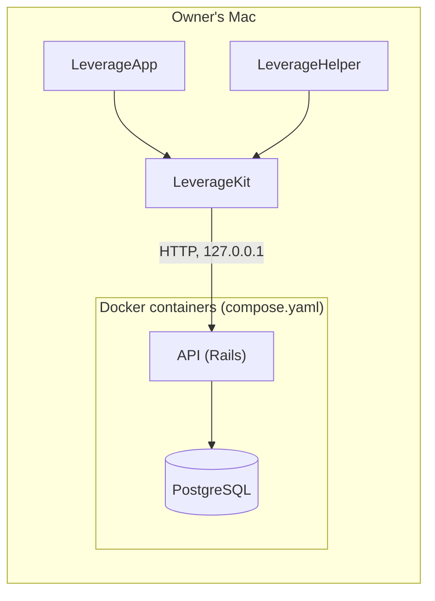

# Architecture

| | |
|---|---|
| **Status** | Rules in force; the skeleton's components, mechanisms and versions recorded; the contract, the data, interfaces and trust boundaries it defines, recorded; no product behavior built |
| **Last updated** | 2026-11-19 |

This document describes how leverage is built: its components, how they
communicate, where data lives, and why the design is the way it is. It
describes the system **as it exists**, not as it is hoped to be. Planned work
belongs in the PRD or in issues.

The technology choices are recorded under
[Technology choices](#technology-choices), the skeleton's components under
[Components](#components), and the contract under [Data](#data),
[Interfaces](#interfaces) and [Trust boundaries](#trust-boundaries). The
[rules](#rules) are in force now.

## Rules

These rules apply to every change, whoever or whatever writes it. Each rule
has a stable ID that is never reused. A pull request answers every **Active**
rule. A **Pending** rule is agreed but does not apply yet; its status names
the pull request that activates it. A **Retired** rule keeps its row and its
heading, so that its ID stays taken, and is no longer answered.

Pending rules are the one exception to this document describing only what
exists. They are recorded before they apply so that the first code is written
knowing them.

| ID | Rule | Status |
|----|------|--------|
| AR-001 | [Requirement-scoped pull requests](#ar-001-requirement-scoped-pull-requests) | Active |
| AR-002 | [One authoritative home per fact](#ar-002-one-authoritative-home-per-fact) | Active |
| AR-003 | [Decision record for hard-to-reverse choices](#ar-003-decision-record-for-hard-to-reverse-choices) | Active |
| AR-004 | [Declared, pinned, justified dependencies](#ar-004-declared-pinned-justified-dependencies) | Active |
| AR-005 | [Declared dependency direction](#ar-005-declared-dependency-direction) | Active |
| AR-006 | [One mechanism per cross-cutting concern](#ar-006-one-mechanism-per-cross-cutting-concern) | Active |
| AR-007 | [Tests that fail before the change, never silently weakened](#ar-007-tests-that-fail-before-the-change-never-silently-weakened) | Active |

A product source file is a source file outside `docs/`, `scripts/`,
`.github/`, and `.agents/`.

### How the rules are applied

1. **Read them before changing anything.** [AGENTS.md](../AGENTS.md) sends
   every agent here first.
2. **Answer them in the pull request.** The description has an "Architecture
   rules" section with one line per active rule, as a bulleted or numbered
   list:

   ```text
   - AR-001: Complies — implements #12
   - AR-003: N/A — no technology or boundary is chosen or changed
   - AR-004: Deviates — docs/adr/0002-short-title.md
   ```

   - `Complies` means the rule covers something in the change and the change
     follows it. Say in a few words what you checked.
   - `N/A` means nothing in the change is covered by the rule. Give the
     reason, in at least two words. AR-001 covers every pull request, so it
     is never `N/A`.
   - `Deviates` means the change breaks the rule and the maintainer has
     agreed to that. For AR-001, give the reason on the line. For any other
     rule the deviation stays in the repository after the merge, so name an
     ADR with status `Accepted` that records why; it may be added by the same
     pull request.

   An answer and its reason go on one line, or continue on indented lines
   directly below it. The section must be visible to a reader: answers inside
   an HTML comment or a code block do not count.
3. **A required check verifies the answers.** `scripts/check_rules.py` runs as
   the "Rules compliance" check. It fails while any active rule lacks an
   answer in one of those forms, and it runs the mechanical part of each
   rule, listed under the rule as "Checked automatically". It takes the rule
   list from the base branch as well as from the pull request, so a pull
   request cannot drop a rule to avoid answering it. A pull request that was
   already passing when a rule became active answers the rule at its next
   push or edit; the check does not rerun on its own. The check does not
   follow symbolic links in the files that decide its result, and it fails
   when git cannot tell it what the pull request changed.
4. **Review judges what the check cannot.**
   - The check proves that each rule was answered in the right form, not
     that the answer is true.
   - The check runs the pull request's own copy of the script and the
     workflow, so a pull request can change the check. When one changes the
     scripts, a workflow, the template, or this section, the check says so in
     a warning.
   - Every `Deviates` answer also produces a warning.
   - Nothing forces anyone to read the answers or the warnings. The ruleset
     on `main` requires no approving review, because a sole maintainer cannot
     approve their own pull request. The maintainer reads them before
     merging.

Dependabot pull requests are exempt from the "Architecture rules" section,
because Dependabot cannot fill it in. The checks on what the change adds still
run on them, and with no answers there is no `N/A` to soften one. A bot's
description is upstream release notes, so the IDs in it are not resolved.

To add, change, activate, or retire a rule, change this section in a pull
request. Activating a rule adds its line to the
[pull request template](../.github/PULL_REQUEST_TEMPLATE.md) and retiring one
removes it; the check fails if the template and the active rules differ.
The pull request that retires a rule still answers it, because the rule is
active on the base branch. A pull request that deletes a rule's row or heading
fails the check: set the rule's status to `Retired` instead.

### AR-001 Requirement-scoped pull requests

Every pull request has one purpose and names what it implements: requirement
IDs from the [PRD](PRD.md), an issue or pull request, or, when there is
neither, the purpose itself in a few words. It changes only what that
requires, plus the bookkeeping the project asks for (the changelog, `AUTHORS`,
and the documents the change affects). Unrequested features, speculative
configuration, and unrelated edits are left out. So is a layer of indirection
(an interface, base class, wrapper, or plug-in point) that the requirement
does not ask for and that has only one implementation behind it; a test
stand-in counts as a second. An unrelated problem is reported as an issue, or
through [SECURITY.md](../SECURITY.md) if it is security-sensitive. This rule
does not replace the [scope policy](../MAINTENANCE.md#scope): a feature still
needs a requirement in the PRD first.

- **Checked automatically:** the answer is `Complies` followed by a
  requirement ID, an issue or pull request number, or a purpose of at least
  two words; or it is `Deviates` followed by a reason.
- **Left to review:** whether the requirement or number cited is real and is
  the reason for the change (a placeholder row in the PRD and a number that
  does not exist both pass the check), and whether the change contains only
  what was required.

### AR-002 One authoritative home per fact

Each of these facts has one home: a requirement in the [PRD](PRD.md), an
architecture decision in its [ADR](#architecture-decision-records), an
architecture rule (`AR-…`) in this section, and an interface definition in
this document. Other files and pull requests refer to them by ID or link and
do not restate them. Naming a rule's subject next to its ID is a reference;
repeating its conditions is a restatement. A generated file whose source is
in the repository is changed only by changing that source and regenerating
it.

- **Checked automatically:** every well-formed `FR-`, `NFR-`, and `AR-` ID
  (prefix, hyphen, three digits) used in a pull request description or in a
  Markdown file under `docs/` is defined in its home, and every `AR-` ID used
  in any Markdown file is defined here. A description may also name an ID
  that the pull request removes. Text inside HTML comments and fenced code
  blocks is not read. `docs/research/` is left out because it is an archive,
  and Markdown files outside `docs/` use requirement IDs only as format
  examples.
- **Left to review:** whether prose restates a fact that already has a home.
  Regenerating generated files in CI waits for the first generator.

### AR-003 Decision record for hard-to-reverse choices

A pull request that makes or changes a hard-to-reverse choice adds an ADR in
`docs/adr/` with status `Accepted`; merging the pull request is the
maintainer's acceptance. Such choices include a language, runtime, framework,
datastore, external service, and component boundary. A change that
contradicts an accepted ADR supersedes that ADR in the same pull request; an
author who does not have the maintainer's agreement to do that stops and asks
first. The format is under
[Architecture decision records](#architecture-decision-records).

- **Checked automatically:**
  - Every file under `docs/adr/` is an ADR with a valid name, a unique
    number, and a valid status, and a superseded ADR names a successor that
    exists.
  - A pull request that adds the repository's first dependency manifest of a
    kind (`package.json`, `go.mod`, `pyproject.toml`, a `Dockerfile`, and the
    like) adds or changes an ADR.
  - A pull request that changes the [Components](#components) or
    [Technology choices](#technology-choices) section adds or changes an ADR.
    Answering `N/A` turns this one failure into a warning, for a change of
    wording only.
- **Left to review:** whether a choice is hard to reverse, whether the ADR
  says what was decided and has the right status, and whether a change
  contradicts an accepted ADR. A language introduced without a manifest is
  not detected.

### AR-004 Declared, pinned, justified dependencies

A pull request that adds a direct dependency (a library, tool, GitHub Action,
or external service) names each one in its description with its license, its
pinned version or commit SHA, and why existing code or the standard library
does not suffice. A library or tool must exist in its ecosystem's official
registry, and its license must be compatible with the MIT License.

- **Checked automatically:** every `uses:` in a workflow under
  `.github/workflows/` or in an action definition (`action.yml`) is written
  on one line and pinned to a full commit SHA, or to a digest for a container
  image. A third-party action or container image that the pull request adds
  is named in the description, and the answer is then not `N/A`.
- **Left to review:** the license, the justification, whether the package is
  the real one, and whether a changed SHA is the release it claims to be.
  The library manifests (`api/Gemfile`, `api/Gemfile.lock`,
  `mac/Package.swift`) and the image and package lines in `api/Dockerfile`
  and `compose.yaml` are not checked automatically: a reviewer compares them
  with the description.

### AR-005 Declared dependency direction

Code imports only along the dependency directions listed under
[Components](#components). A pull request that needs a new direction changes
that list, with an ADR, in the same pull request.

- **Checked automatically:** `scripts/check_imports.py`, the "Import
  directions" job in CI, reads the
  [allowed dependency directions](#allowed-dependency-directions) and fails
  when a Swift file imports a code unit its own unit may not import, when a
  Ruby file loads a file outside its unit's folder, or when a Swift or Ruby
  file outside `docs/`, `scripts/`, `.github/`, and `.agents/` is in no listed
  unit (`mac/Package.swift`, the package manifest, excepted). Because the
  list is in the Components section, changing it also needs an ADR under
  rule AR-003.
- **Left to review:** a dependency the check cannot see: a file loaded
  through a computed path, a target dependency in `mac/Package.swift` that
  no source file imports, and a call between components that is not an
  import (the Mac side reaches the API only over HTTP).

### AR-006 One mechanism per cross-cutting concern

Each cross-cutting concern (errors, logging, configuration, persistence,
shared helpers) has one designated mechanism, named in this document. A pull
request uses it and does not add a second mechanism or a duplicate of
something it already provides.

The mechanisms are listed under
[Cross-cutting mechanisms](#cross-cutting-mechanisms).

- **Checked automatically:** nothing.
- **Left to review:** whether a change uses the listed mechanism, and
  whether it adds a second one. A change that needs a new mechanism, or a
  first one where the list says "none yet", changes the list in the same
  pull request.

### AR-007 Tests that fail before the change, never silently weakened

A pull request that changes behavior adds or updates at least one test that
fails on the base branch and passes with the change. It does not delete,
skip, or loosen an existing assertion unless its description names the
assertion and the reason.

- **Checked automatically:** for the API and the Mac side only. Their
  product source is any file under `api/` or `mac/` that is not Markdown and
  not in a test folder. A test file is a `.rb` or `.swift` file under
  `api/test/` (for `api/`) or `mac/Tests/` (for `mac/`), and it counts only
  for its own component and only if the lines the pull request adds to it
  include an assertion.
  - A pull request that adds, changes, or deletes product source in a
    component, and adds no assertion to a test file of that component,
    fails. Answering `N/A` with a reason turns the failure into a warning,
    for a change with no behavior in it; a `Deviates` answer with its
    accepted ADR passes. A bot's pull request is held to this too; a
    maintainer answers for it by adding an AR-007 line to its description.
  - A pull request that removes or changes an assertion line or a test
    definition line (`test "..."`, `def test_`, `@Test`, `func test`) in an
    existing test file, deletes a test file that has assertions, or adds a
    skip to an existing test file gets a warning that names the file and the
    lines. The description must name each one and the reason.
- **Left to review:** product source outside `api/` and `mac/` (a Swift or
  Ruby file there also fails the AR-005 check until its unit is listed),
  whether the new test fails on the base branch, whether it tests the
  behavior that changed, whether a warned line really weakens the test,
  whether the description names it, and other ways to disable a test that
  the check does not recognize.

## Engineering practices

These are how the work is done. The [rules](#rules) say what a pull request
must satisfy; where a practice is also a rule, the rule is the authority.

- **Test-driven development.** Write the test first, see it fail, make it
  pass, then tidy with the tests green. Rule AR-007 is the requirement. To
  show it, commit the test before the code, or quote the test's failure on
  the base branch under "How it was verified".
- **The contract first.** What two parts share (tables, event types, the
  fixed lists, the interface schema) is written and reviewed before either
  part is built, and it lives in one place. Parts are built against it, with
  stand-ins where the other side does not exist yet.
- **Small steps that leave `main` working.** Every merge leaves the checks
  green and the product runnable; how work is split into pull requests is
  [AR-001](#ar-001-requirement-scoped-pull-requests).
- **Tests at the level of the behavior.** Unit tests for rules that are pure
  logic, tests against the interface schema for every call, and a run of the
  whole task loop for what crosses parts. A provider's tool is replaced by a
  stand-in in automated tests; nothing in CI calls a provider.
- **No secret in the repository, a log, an event, a fixture or a
  screenshot.** Tests use made-up values. Records name a credential by its
  id.
- **An adversarial review before merge in a delegated run.** In a run
  delegated under [CONTRIBUTING.md](../CONTRIBUTING.md#ai-assisted-contributions),
  a reviewer who did not write the change tries to break it, and its
  findings are fixed or answered in the pull request.
- **Documents in step.** A change that alters behavior, structure,
  configuration or deployment updates the matching document, and
  [IMPLEMENTATION.md](IMPLEMENTATION.md), in the same pull request.

## System overview



Today the system is a skeleton: no PRD behavior is built. The API runs in a
Docker container next to a PostgreSQL container on the owner's Mac, and
answers only on the Mac's loopback address. The Mac app and the helper are
built from one Swift package and reach the API only through LeverageKit,
which sends `GET /v1/health` and decodes the answer. Nothing else crosses a
component boundary yet.

## Components

Four components exist. The roles [ADR 0001](adr/0001-rails-api-postgresql-and-a-mac-client.md)
gives them are not built yet; each entry says what the code does today.

### API

- **Responsibility:** the server of a workspace. Today it answers
  `GET /v1/health` with its status and version, and Rails' own `GET /up`.
- **Owns:** the PostgreSQL database and the HTTP interface under `/v1`.
- **Depends on:** PostgreSQL, reached through `DATABASE_URL`, and the gems in
  `api/Gemfile`. It depends on no other component.
- **Code:** `api/`, a Rails application in API mode; tests in `api/test/`. It
  runs in the containers described by `compose.yaml`. It also holds the
  contract, `api/contract/`, and `Leverage::Contract` and `Leverage::Gating`
  in `api/lib/leverage/` (see [Interfaces](#interfaces)); the Docker build
  context is `api/`, so the image holds the contract.

### Shared Swift library (LeverageKit)

- **Responsibility:** the Mac side's one client of the API
  (`LeverageClient`), its configuration (`Configuration`), and the helpers
  the app and the helper share.
- **Owns:** every HTTP call from the Mac side to the API, and the decoding of
  the answers.
- **Depends on:** Foundation, and the API over HTTP.
- **Code:** `mac/Sources/LeverageKit/`; tests in `mac/Tests/LeverageKitTests/`.

### Mac app (LeverageApp)

- **Responsibility:** the owner's window. Today it shows the app's name and
  the API's health line, refreshed by a button.
- **Owns:** nothing stored.
- **Depends on:** LeverageKit and SwiftUI.
- **Code:** `mac/Sources/LeverageApp/`.

### Mac helper (LeverageHelper)

- **Responsibility:** a command-line program on the owner's Mac. Today it
  prints its version and the API's health line, and exits 0 when the API
  answers healthy and 1 otherwise.
- **Owns:** nothing stored.
- **Depends on:** LeverageKit and Foundation.
- **Code:** `mac/Sources/LeverageHelper/`.

### Allowed dependency directions

Code imports only along these directions (rule AR-005). Each code unit is a
Swift target or the Rails application; "may import" lists the other code
units it may import, and nothing else of ours. Platform modules and
libraries are not code units: rule AR-004 covers them. Across components,
the Mac side reaches the API only over HTTP, through LeverageKit, and the
API calls nothing on the Mac side.

| Code unit | Folder | May import |
|---|---|---|
| `LeverageKit` | `mac/Sources/LeverageKit/` | nothing |
| `LeverageHelper` | `mac/Sources/LeverageHelper/` | `LeverageKit` |
| `LeverageApp` | `mac/Sources/LeverageApp/` | `LeverageKit` |
| `LeverageKitTests` | `mac/Tests/LeverageKitTests/` | `LeverageKit` |
| `api` | `api/` | nothing |

`python3 scripts/check_imports.py` checks the code against this table.

## Cross-cutting mechanisms

Each concern has one mechanism on each side (rule AR-006). "None yet" means
the first change that needs one chooses it and adds it here.

| Concern | API (`api/`) | Mac side (`mac/`) |
|---|---|---|
| Errors | `ApplicationController` answers every unhandled error with `{"error":{"code","message"}}` and the status Rails maps the error to: it rescues errors raised in a controller, and `ApplicationController.exceptions_app`, Rails' exceptions app, answers errors raised before one runs (in the router or a middleware). A 5xx answer hides the message, which is logged. | `LeverageClientError` in LeverageKit for the errors the client raises; a transport failure passes through as the `URLError` that `URLSession` threw. |
| Logging | `Rails.logger`; in production to standard output, tagged with the request ID. | None yet. The helper writes its result to standard output and a failure to standard error. |
| Configuration | Environment variables, set from `.env` through `compose.yaml` and read under `api/config/`. | `Configuration` in LeverageKit, read from the process environment (`LEVERAGE_API_URL`). |
| Persistence | Active Record on PostgreSQL. | None. |
| Shared helpers | `Leverage::Contract` (`api/lib/leverage/contract.rb`) reads `api/contract/` and validates a payload against its schema with `json_schemer`. | LeverageKit. |

## Data

- **Where.** PostgreSQL, in the `db` container, is the only store. The PRD's
  [Data model](PRD.md#data-model) is the requirement; `api/db/structure.sql`
  is the schema, built by the migrations in `api/db/migrate/`. It has the
  26 tables the Data model names plus `sessions`, `helper_requests` and
  `briefing_acknowledgements` (owner sign-in, the helper's requests and
  briefing acknowledgements), 29 in all, and each but `workspaces` has a
  `workspace_id` with a foreign key. CI migrates from zero, with
  `structure.sql` moved away so the migrations run, and fails when the
  result differs from the committed file.
- **Who writes.** No product code reads or writes the tables yet. The
  schema itself refuses what the PRD forbids:
  - `events` and `rule_versions` are append-only: a trigger refuses
    `UPDATE`, `DELETE` and `TRUNCATE` for every role. A superuser or the
    table owner can still switch the triggers off, so the guarantee holds
    only once the API logs in as a member of `leverage_app` (planned for
    the Core loop).
  - A task's state changes only in a transaction that writes an event for
    that task in its workspace: two deferred constraint triggers on
    `tasks` check at commit for an `events` row whose `xact_id` (set by
    default to `pg_current_xact_id()`) is the transaction's own.
  - `rule_checks (rule_id, rule_version_id)` and `rules (id,
    current_version)` are composite foreign keys, so a check's version and
    a rule's current version belong to that rule.
  - A seat reviews at most one review at a time: the unique index on
    `reviews.reviewer_seat_id` counts only reviews with no verdict.
  - The `leverage_app` role (`NOLOGIN`, kept by the `db:grants` task after
    every task that builds or changes the schema) has `SELECT, INSERT` on
    `events` and `rule_versions`, `SELECT, INSERT, UPDATE, DELETE` on every
    other table, and no `TRUNCATE`. The API still connects as the
    database's owner role from `.env`; no login uses `leverage_app` yet.
- **What is never stored.** No column holds a token or a password in the
  clear: the only such names are `token_hash` (`sessions`, `helpers`,
  `seats`) and `users.password_digest`. A check constraint refuses any key
  named `token` or ending in `_token`, in any letter case and at any
  depth, in `commands.result`, `commands.refusal` and
  `helper_requests.result`; a count named `tokens` is allowed. A credential is a row with a name, a kind and
  a state; no login, sign-in token, settings folder or keychain reference
  has a column.
- **How long.** The PRD's Data model says what is kept and for how long;
  nothing deletes a row yet.
- **Values.** Closed values are plain `text` columns, checked by the
  application against `api/contract/registry.json`; there is no PostgreSQL
  enum type. Durations that are settings are integer seconds.

## Interfaces

`api/contract/` is the definition of every interface between two parts of
leverage; [its README](../api/contract/README.md) says how each file is
written and read. This section is the pointer AR-002 asks for, and states
the stability rules.

| Interface | Defined in |
| --- | --- |
| The agent, owner and helper HTTP interfaces | `api/contract/openapi.json` (OpenAPI 3.1, tags `agent`, `owner`, `helper`) |
| Events: types and payloads | `api/contract/registry.json` and `api/contract/payloads/<type>.v<n>.json` |
| The fixed lists every part uses | `api/contract/registry.json` |
| States, commands, steps, hooks, jobs, roles, timers, Needs you | `api/contract/*.json`, one file each |
| The transition function and rule gating, in process | `Leverage::Gating` (`api/lib/leverage/gating.rb`) and the conformance suite `api/test/support/gating_conformance.rb` |
| Credential readers | `api/contract/readers.json` |
| Expected behavior, end to end | `api/contract/traces/` |

Only `GET /v1/health` is served today; the other operations are defined
and not built.

- **Commands.** Every call that changes something is a `POST` that carries
  an `Idempotency-Key` header and answers one outcome body: 200 completed,
  202 pending, 409 refused with a code from the registry's `refusals`.
- **Events** are versioned. A released payload version is never edited: a
  change adds a new version, the server writes the newest, every reader
  handles every listed version, and old events are never rewritten.
- **Lists.** A value of a list the PRD tables changes the PRD first.
  `scripts/check_registry.py` and `scripts/check_contract_tables.py` fail
  in CI when the PRD and the contract differ.
- **Provisional parts** are marked: owner reads with `x-provisional: true`
  in `openapi.json`, and readers with `provisional: true` in
  `readers.json`. They may change without a new version until they are
  marked final.

## Trust boundaries

What the contract defines at each boundary; none of it is enforced by
running code yet, except where the database does it. Security review
starts here; see [SECURITY.md](../SECURITY.md).

- **Callers and their credentials.** Three callers reach the server, each
  with its own bearer token: a seat (`seatBearer`), the owner's session
  (`ownerSession`, from `POST /v1/owner/session`) and the helper
  (`helperBearer`, issued by an owner command). Each is shown once and
  stored hashed (`token_hash`). `x-leverage-caller` on each operation and
  `roles.json` say which caller may run it.
- **Untrusted input.** Everything a seat sends (contract text, notes,
  evidence, questions, answers), every model job result and every helper
  report is untrusted. Job results and reports have fixed shapes in
  `openapi.json`, and an event payload holds only ids, numbers, digests
  and values from closed lists, never free text. The one exception is
  `model` (in `task.claimed`, `review.started`, `job.claimed` and
  `credential.switched`), a model name of at most 128 characters from a
  fixed character set that has no `@`, so it cannot hold an email
  address. A link is never fetched.
- **Secrets.** No request or stored outcome carries a provider login,
  sign-in token, link, code or API token; the four one-time tokens appear
  only in the response that issues each.
- **Privilege changes.** The owner's commands and the seats' calls are
  separate operations with separate schemes. In the database, the
  migrations run as the owner role and `leverage_app` cannot change the
  event log; every table but `workspaces` is scoped by `workspace_id`.
- **Network.** `compose.yaml` publishes the API on `127.0.0.1` only.

## Technology choices

Each choice is recorded in the ADR named beside it.

| Part | Choice | Decided in |
| --- | --- | --- |
| Backend | Ruby on Rails, API mode, in `api/` | [ADR 0001](adr/0001-rails-api-postgresql-and-a-mac-client.md) |
| Datastore | PostgreSQL | [ADR 0001](adr/0001-rails-api-postgresql-and-a-mac-client.md) |
| Hosting | A server the owner controls, one installation per owner; for the first run, the owner's Mac | [ADR 0001](adr/0001-rails-api-postgresql-and-a-mac-client.md) |
| Docker containers | The backend ships as a container image; the backend and PostgreSQL run in Docker containers | [ADR 0001](adr/0001-rails-api-postgresql-and-a-mac-client.md) |
| Owner's interface | A native Mac app in Swift with SwiftUI, a thin client of the API, in `mac/` | [ADR 0001](adr/0001-rails-api-postgresql-and-a-mac-client.md) |
| Mac helper | Runs the providers' tools on the owner's Mac; written in Swift, in `mac/` | [ADR 0001](adr/0001-rails-api-postgresql-and-a-mac-client.md) |
| Ruby and Rails | Ruby 4.0.10 (image `ruby:4.0.10-slim`), Rails 8.1.4.1; gem versions fixed in `api/Gemfile.lock` | [ADR 0002](adr/0002-pinned-versions-test-tools-and-code-units.md) |
| PostgreSQL version | 17.12 (image `postgres:17.12-trixie`) | [ADR 0002](adr/0002-pinned-versions-test-tools-and-code-units.md) |
| API checks | Minitest, RuboCop (`rubocop-rails-omakase`) | [ADR 0002](adr/0002-pinned-versions-test-tools-and-code-units.md) |
| Swift | Swift tools version 6.2, macOS 14 or later, no third-party packages | [ADR 0002](adr/0002-pinned-versions-test-tools-and-code-units.md) |
| Swift tests | Swift Testing | [ADR 0002](adr/0002-pinned-versions-test-tools-and-code-units.md) |
| Continuous integration | GitHub Actions: `ubuntu-24.04` for the API and the import check, `macos-26` for Swift | [ADR 0002](adr/0002-pinned-versions-test-tools-and-code-units.md) |
| Code units | `api`, `LeverageKit`, `LeverageApp`, `LeverageHelper`, with the directions under [Components](#allowed-dependency-directions) | [ADR 0002](adr/0002-pinned-versions-test-tools-and-code-units.md) |
| The contract | JSON data files with JSON Schema 2020-12, OpenAPI 3.1, `structure.sql`, the `leverage_app` role, `json_schemer` 2.5.0 | [ADR 0003](adr/0003-contract-format.md) |

## Architecture decision records

Significant, hard-to-reverse decisions are recorded as short ADRs in
`docs/adr/`, one file each, numbered upward from `0001`
(`0001-short-title.md`). The folder holds nothing else. Rule AR-003 says when
an ADR is required, and "How the rules are applied" says when one records an
agreed deviation from a rule. Each ADR follows this outline and stays short:

```markdown
# 0001. Short title

Status: Accepted

## Context

## Decision

## Alternatives considered

## Consequences
```

The status is one of `Proposed`, `Accepted`, `Rejected`, `Deprecated`, or
`Superseded by 0002` (the number of the ADR that replaces it). Only an
accepted ADR is binding, and the maintainer accepts one by merging the pull
request that gives it that status. `Deprecated` marks a decision that no
longer applies and has no successor. Once an ADR is accepted its decision is
not rewritten: only its status line changes, apart from repairs such as a
broken link, and a later ADR supersedes it. If two open pull requests take
the same number, the second to merge takes the next one.

Recorded so far:

- [0001. Rails API with PostgreSQL, a Mac client and a Mac helper](adr/0001-rails-api-postgresql-and-a-mac-client.md)
- [0002. Pinned versions, test tools and code units of the skeleton](adr/0002-pinned-versions-test-tools-and-code-units.md)
