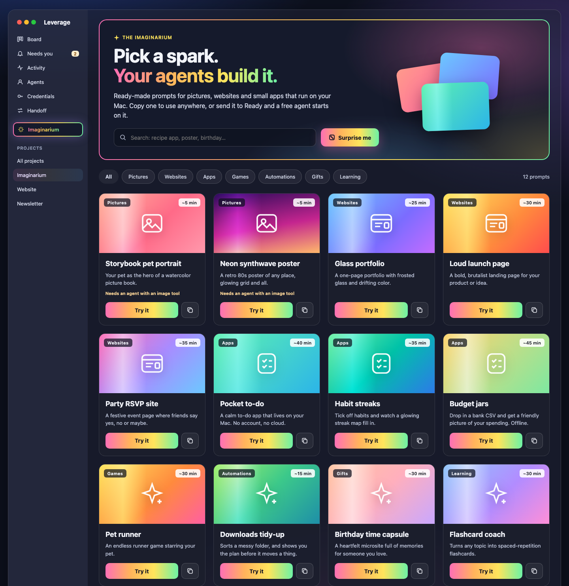
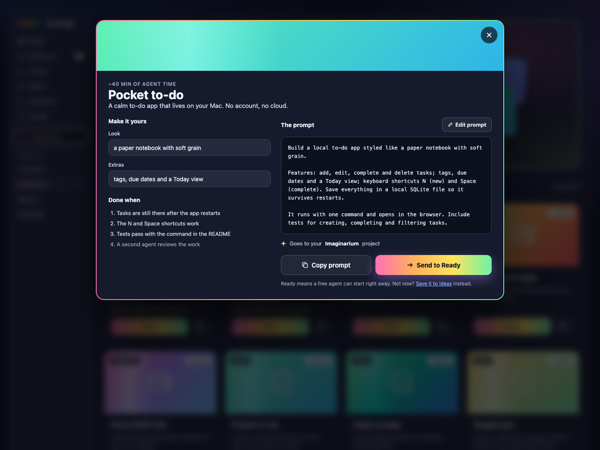
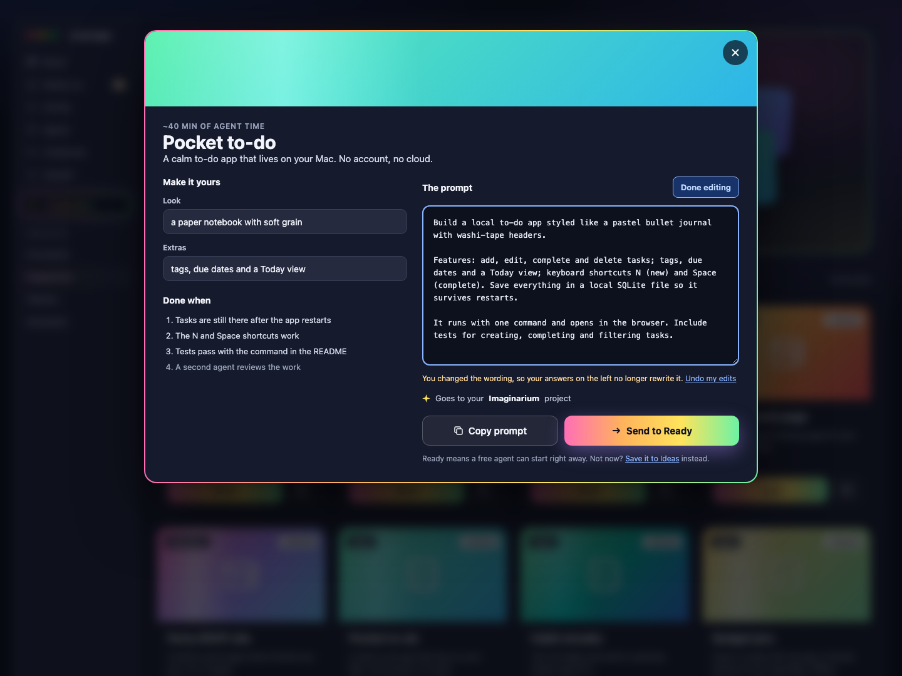
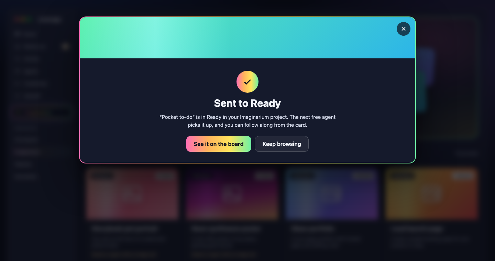

# The Imaginarium

Status: Proposed, for the maintainer's review (24 November 2026)

The Imaginarium is a tab in the Mac app where the owner browses ready-made
prompts that make something fun: a picture in a style, a website in a style,
or a small app that runs on their Mac. For any prompt, the owner can copy it,
edit it, or send it to Ready so that a free agent builds it. Every prompt sent
from the Imaginarium lands in one project, also called Imaginarium, which every
workspace has from the start.

This file is a proposal. Requirement IDs use the prefix `IM-` so they cannot
be mistaken for accepted `FR-` and `NFR-` requirements. When the maintainer
accepts the proposal, its requirements move into [docs/PRD.md](../PRD.md)
with `FR-` IDs, and this file keeps only the design reference, so that each
requirement has one home.

## Design reference

Gallery mockup A is the design to build. [`gallery.html`](gallery.html) is a
self-contained, clickable version of it that loads nothing from the network.
The address fragment opens a state directly, for example `#open=todo`,
`#open=todo&edit=1` or `#open=todo&sent=ready`. As with
[the main mockup](../design/README.md), the tokens and layout carry over to
the SwiftUI app; the HTML, CSS and JavaScript do not. The prompts in it are
sample entries.

The gallery, with the Imaginarium item selected in the side pane and the
Imaginarium project, tinted faintly, in the project list:

Try it, with the fill-ins, the Done when list, the prompt and the two actions:

Edit prompt, after the owner has changed the wording:

After Send to Ready:

## Why

A new owner connects agents and then faces an empty board. The Imaginarium
gives them something worth building in one click. It shows what a good task
looks like, a clear goal with Done when checks, and gets a first task to Done
without the owner having to write one.

## Out of scope for version 1

- Prompts that owners write and share, a marketplace, ratings or payments.
- Choosing a project when sending. Imaginarium tasks always go to the
  Imaginarium project.
- Downloading new prompts from the internet. The catalog ships with the app.
- Adding an image-generation tool to Leverage. Picture prompts rely on an
  agent that already has one.

## Part 1: rename the board's first lane to Ideas

Do this first. Today `imaginarium` is the engine's name for a task state:
the first lane of the board, which the app already labels "Ideas". Keeping
both meanings would confuse everyone who reads the code or the PRD. The name
appears about 140 times across `api/contract`, the engine's transition
entries, the generated Swift in `LeverageKit`, the board, tests and docs.

| ID | Requirement |
| --- | --- |
| IM-1 | The task state `imaginarium` becomes `ideas` everywhere: `task_states` in `api/contract/registry.json`, the effect `adds_to_imaginarium` (now `adds_to_ideas`), payload schemas, traces, the engine's transition entries, the generated Swift, the board, the Add task form, tests and fixtures. The lane label stays "Ideas". |
| IM-2 | Tasks already stored in the old state move to `ideas` in a database migration. The event log is append-only and is not rewritten: whatever reads events accepts the old spelling as `ideas`, and a test replays an old log to prove it. |
| IM-3 | [docs/PRD.md](../PRD.md) says "Ideas" for the lane and the state, and takes "Imaginarium" off its list of engine terms that must not reach an owner-facing screen. From then on, "Imaginarium" means only this feature and its project. |
| IM-4 | A case-insensitive search for `imaginarium` in `api/` and `mac/` finds only code for this feature and the old-spelling reader of IM-2, and every server and Mac test passes. The rename ships as its own pull request, before anything else here. |

## Part 2: every workspace has an Imaginarium project

Part 2 is built, and IM-5 to IM-7 are now in [docs/PRD.md](../PRD.md#the-imaginarium-project), which is their home.

| ID | Requirement |
| --- | --- |
| IM-5 | Creating the owner's sign-in on a new installation, the setup command in [`setup_controller.rb`](../../api/app/controllers/v1/owner/setup_controller.rb), also creates a project named "Imaginarium" in the same transaction, writing `project.created`. Setup cannot finish without it. |
| IM-6 | An existing installation gets the project once, when an update of the app starts its server, through a command that skips a workspace that already has it. Running it twice creates nothing new. No payment or plan change is involved. |
| IM-7 | The workspace records which project is the Imaginarium project by its id, not by its name. In every other way it is an ordinary project, with a brief, a budget and a pause. It is listed first among the projects in the side pane, as a plain project row with a faint rainbow tint and no icon, so that it reads as related to the Imaginarium tab. |
| IM-8 | Every task sent from the Imaginarium goes to this project. The Try it sheet offers no project choice. The owner can still move a task to another project later with the existing command that changes a task's project. |

## Part 3: the Imaginarium tab

| ID | Requirement |
| --- | --- |
| IM-9 | The side pane has an "Imaginarium" item below Handoff, drawn with the rainbow outline in the design reference. It opens the gallery: a heading, a search field, a "Surprise me" button that opens a random prompt, category filters (All, then one per category) and a grid of tiles. |
| IM-10 | Each tile shows its category, title, one-line description, an agent-time estimate (for example "~25 min"), a "Try it" button and a copy button. A prompt that needs an image tool says "Needs an agent with an image tool". |
| IM-11 | "Try it" opens a sheet with the time estimate, the title, the one-line description, a "Make it yours" field for each fill-in the prompt has, the Done when list, and the prompt. The sheet shows no category and no project choice. A line under the prompt says it goes to the Imaginarium project. |
| IM-12 | Each fill-in starts with the catalog's default. Changing it updates the prompt as the owner types. |
| IM-13 | "Edit prompt" turns the prompt into editable text, and "Done editing" turns it back. Once the owner has edited it, the text is theirs: fill-ins stop rewriting it, and the sheet says so. "Undo my edits" returns to the filled-in prompt. |
| IM-14 | The Done when list shows the catalog's checks, then "A second agent reviews the work", which every task gets as its last check. |
| IM-15 | "Copy prompt" copies exactly the text shown, edited or not, and says "Copied". Copying adds nothing to the board and sends nothing to the server. |
| IM-16 | "Send to Ready" runs the same two commands as saving the Add task form, Add task and then Complete contract, in the Imaginarium project. The title is the prompt's title, the goal is the text shown, the acceptance criteria are the Done when checks, and the priority is normal. If `task.before_ready` stops it, the task stays in Backlog and the sheet shows the reason, as Add task does. |
| IM-17 | "Save it to Ideas", a small link under the two buttons, runs Add task into the `ideas` state with the same contract, so that promoting it later needs no retyping. |
| IM-18 | After either action, the sheet says where the task went and offers "See it on the board" (the board, filtered to the Imaginarium project) and "Keep browsing". Pressing a button twice creates one task: both presses share one command id. |
| IM-19 | A task made from the Imaginarium records its catalog entry id and the catalog version, and its card shows an "Imaginarium" badge. Event payloads carry the entry id only, never prompt text, because events hold no content. |

## Part 4: the catalog

Part 4 is built, and IM-20 to IM-23 are now FR-026 to FR-029 in
[docs/PRD.md](../PRD.md#the-prompt-catalog-functional-requirements),
which is their home. The catalog is JSON compiled into the app rather than
a separate file in the app bundle.

| ID | Requirement |
| --- | --- |
| IM-20 | The catalog is a versioned JSON file shipped inside the app. In version 1 the app never fetches prompts from the network. |
| IM-21 | Each entry has an id, a category, a title, a one-line description, a time estimate, one to four fill-ins (key, label and default), a prompt template that names each fill-in as `{key}`, one to four Done when checks, and an optional list of what it needs, such as an image tool. |
| IM-22 | A test loads the catalog and fails if a template names a key with no fill-in, a fill-in is unused, an entry has no Done when check, or two entries share an id. |
| IM-23 | The launch catalog has 32 prompts in 8 categories: Pictures, Websites, Apps, Games, Automations, Gifts, Learning, and Home and life. Each asks for something that runs or opens on the owner's Mac with no account and no cloud service. |

## Done when

1. No task state, effect or label named `imaginarium` is left, an old event
   log still replays, and every test passes (IM-1 to IM-4).
2. A new installation has the Imaginarium project right after setup,    updated one gets it exactly once (IM-5, IM-6).
3. From the tab, Send to Ready puts a task in Ready in the Imaginarium
   project, with the catalog's checks as its criteria and the text shown,
   edited or not, as its goal.
4. Copy prompt puts the text shown on the clipboard and changes nothing on
   the board. Save it to Ideas puts the task in Ideas.
5. The catalog test passes on all 32 entries.

## Build order

1. The rename (Part 1), as its own pull request.
2. The Imaginarium project at setup and on an app update (Part 2).
3. The catalog file and its test (Part 4).
4. The tab, the Try it sheet, and the Copy, Edit, Send to Ready and Save to
   Ideas actions (Part 3).

## Open questions

- **Where agents build.** An Imaginarium task needs a folder to work in.
  Proposal: a new folder per task under `~/Leverage/Imaginarium/`, set as the
  task's work reference when it is sent.
- **Picture prompts with no image tool.** Should Send to Ready be refused, or
  should the task wait in Blocked with a Needs you item until an agent with an
  image tool connects?
- **Renaming or deleting the project.** Proposal: the owner may rename the
  Imaginarium project but not delete it.
- **The specific-details check.** Catalog prompts are written to pass it.
  Should it still run, at a model-check cost, on prompts the owner has not
  edited?
