# Onboarding

This document defines how a new owner gets from a new installation of
Leverage to a first finished task: the setup assistant, and the setup
checklist that takes over when the assistant is left.

It adds to [docs/PRD.md](../PRD.md), which lists both screens under
[What the app shows in version 1](../PRD.md#what-the-app-shows-in-version-1).
The PRD's [terms](../PRD.md#terms) and its rule for owner-facing words apply
here. Requirement IDs in this document start `OB-`.

## Why

Before onboarding, a new owner landed on six empty lanes that each said
"Nothing here". Nothing can run until four things are true, and the app said
so only on each thing's own tab:

1. Two logins are added, from two providers. The rule "A different provider
   reviews every task" ships on, so with one provider a finished task waits
   with nobody to review it.
2. An agent is connected for each login.
3. A task is sent to the agents.
4. The task is built, reviewed and Done.

Onboarding walks the owner through these in order, and never lies about
them: every step is read from the workspace, so it is done when it is true,
whichever screen made it true.

## The two parts

| Part | When the owner sees it | Mockup |
| --- | --- | --- |
| Setup assistant | On a new installation, right after "Create your sign-in" | [setup-assistant.html](setup-assistant.html) |
| Setup checklist, with its spotlight | After the owner leaves the assistant before sending a first task | [checklist-spotlight.html](checklist-spotlight.html) |

The mockups are clickable pages that load nothing from the network. Each
has a grey bar across the top that is not part of the design; it jumps to
any point of setup and switches between light and dark. The pictures below
are of the mockups, in the dark appearance. Where a mockup and this
document differ, this document is right. Two differences are known: the
mockups' tasks, logins and names are sample data, and the mockup of the
assistant plays the one-provider case further than the assistant does.

## What decides which part shows

| ID | Requirement |
| --- | --- |
| OB-1 | The four steps are never stored. The app reads them from the logins, the agents and the tasks each time: two providers have a login, agents of two providers are connected, a task has left Ideas and Backlog, and a task is Done. An API token is not a login. A removed agent does not count. |
| OB-2 | The app keeps one word on this Mac, in `setup-progress` in the support folder: nothing yet, the assistant was opened, the assistant was left, or setup is over. It holds no secret. |
| OB-3 | The first read after sign-in decides what the window shows, once. A new installation, which has no login, no agent and no task, opens the setup assistant. |
| OB-4 | An assistant that was opened and neither finished nor left opens again at the next launch, at the first screen that still has something to do. |
| OB-5 | After the assistant was left, the app shows with the setup checklist until all four steps are done or the owner hides it. |
| OB-6 | A workspace that already holds a login, an agent or a task when the app first has onboarding never gets the assistant. It gets the checklist if a step is not done, and nothing if all four are. |
| OB-7 | A step turning true never moves the owner to another screen by itself. |
| OB-8 | While the first read has not answered, the signed-in window draws nothing, so the app never shows for a moment before the assistant. If that read fails, the app shows as it is, and a later read may bring the checklist but never opens the assistant over the app. |

## Setup assistant

The assistant fills the window. There is no side pane until it ends. A
stepper across the top names the four parts: Welcome, Logins, Agents and
First task. Back and one raised button sit at the bottom, and "Set up
later" is at the top right of every screen.

| ID | Requirement |
| --- | --- |
| OB-10 | **Welcome.** One sentence says what Leverage does, and three small pictures say how: the owner adds a task, one agent builds and another reviews, and the owner is asked only when it matters. A line says setup takes about five minutes and needs two AI subscriptions the owner already pays for. |
| OB-11 | **First login.** The owner picks one of the four login providers, names the login and chooses Sign in. The assistant runs the same three checks as Add credential, with the same sentences, the same offer to install a missing tool, and Retry after a failed check. Continue is available once the login is added. API tokens are not offered here. |
| OB-12 | Each provider's tile names the tool it runs in. Gemini's tile says "Builds, but does not review yet". |
| OB-13 | **Second login.** The same screen, asking for a different provider and saying why. A provider that already has a login is marked "Already added" and cannot be picked. |
| OB-14 | "I only have one subscription" says that finished work will wait in Needs you until a second provider is added or the review rule is turned off in Settings, and offers "Continue with one". |
| OB-15 | **Agents.** One row for each login, named after it, with the role General and a switch that is on. "Start agents" connects a General agent the app runs for each login that is switched on and has no agent yet. Connecting starts it. When a login's name is already an agent's name, the next free "Claude, Personal 2" is used, because this screen has no name field. A login that already has an agent is shown as connected. |
| OB-16 | With one provider, the Agents screen says again that finished work will wait for a review. |
| OB-17 | **First task.** Three built-in starter tasks, each with a category, a time, one sentence and the list it is done when: Pocket to-do, Glass portfolio and Downloads tidy-up. "Write my own" takes what should get done and how the owner will know it is done; both are needed, because a task without them stays in Backlog. As on every task, the independent review is added as the last criterion. |
| OB-18 | "Send to agents" adds the task with its contract, exactly as Add task does. Setup is then over: the app shows the task board, and one line that the owner can close names the task and says that anything that needs them shows up in Needs you. |
| OB-19 | "Set up later" on any screen, and "Skip, take me to the board" on the last, close the assistant and open the task board with the setup checklist. |

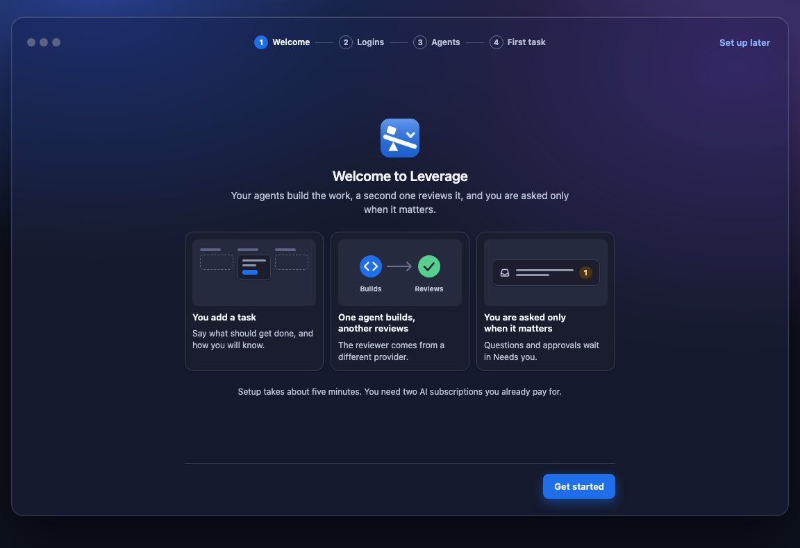

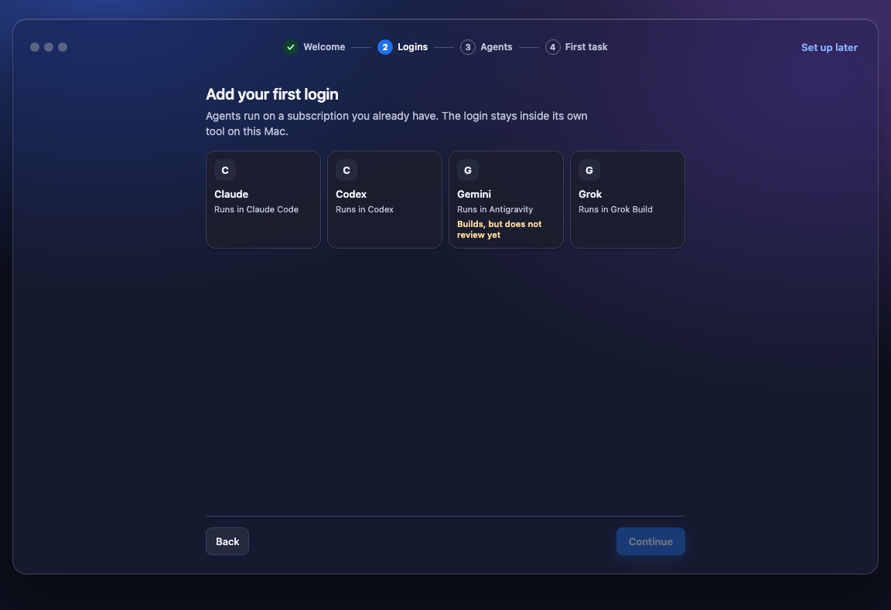

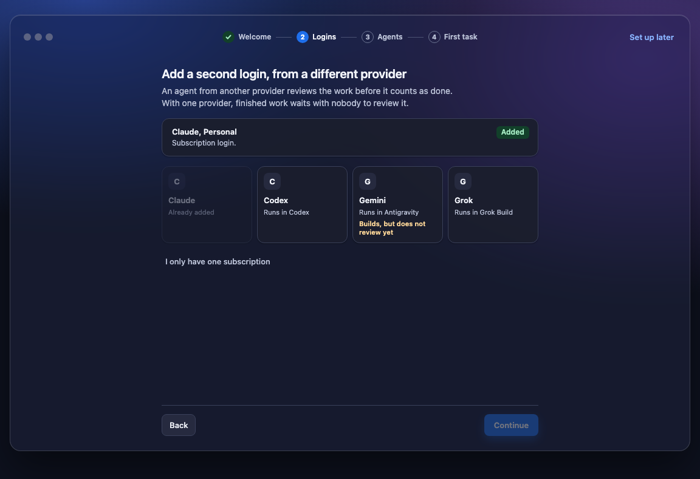

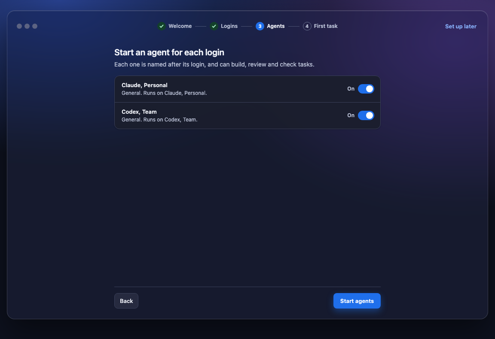

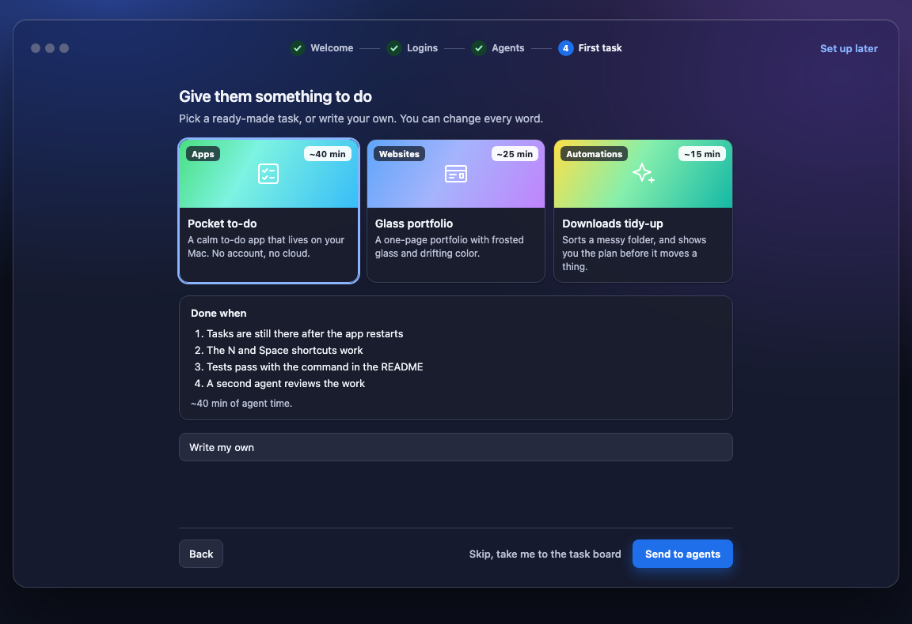

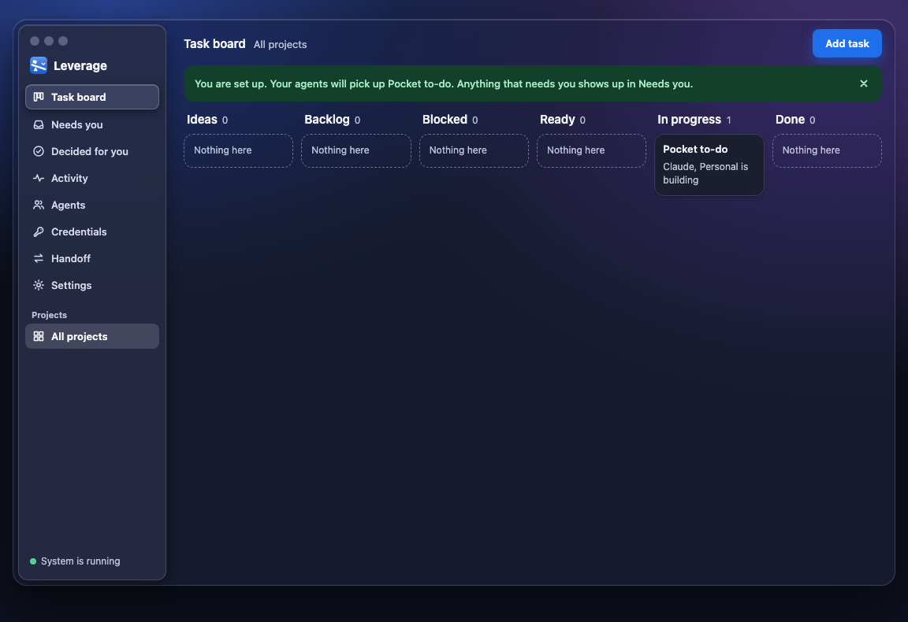

## Setup checklist

The checklist is a card at the top of the task board, titled "Get your
first task done", with a meter and four steps. Setup progress also shows in
the side pane, above the health line, on every tab.

| ID | Requirement |
| --- | --- |
| OB-20 | The card's four steps are: Add two logins, Connect an agent for each, Send your first task, and See it reach Done. A done step says what was done. The first step that is not done is outlined and has "Show me". Later steps are muted. |
| OB-21 | While the last step is the current one, it shows what the task is doing instead of a button. |
| OB-22 | "Hide this" on the card ends setup at any point. When all four steps are done the card becomes one line with "Finish setup". Either is kept, and the card does not come back. |
| OB-23 | The side pane shows "Setup" and how many of the four steps are done. Choosing it opens the task board. |

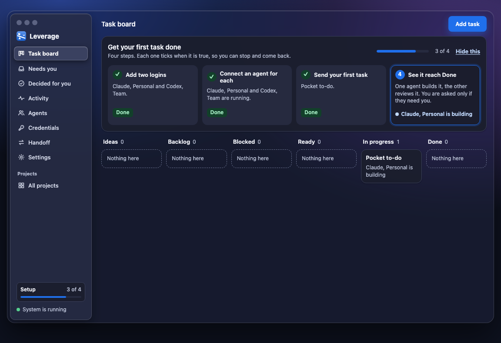

### The spotlight

The spotlight dims the window and leaves one control lit, with a ring, an
arrow and a note that says in one sentence why to press it.

| ID | Requirement |
| --- | --- |
| OB-30 | Only the lit control can be pressed. Every other click does nothing. |
| OB-31 | What is lit follows the current step and the tab the owner is on: the Credentials tab, then Add credential; the Agents tab, then Connect agent; then Add task. While the first task runs nothing is lit. When it is Done, its card on the task board is lit and the note has "Finish setup". |
| OB-32 | The note names the step, "Step 2 of 4", and uses the owner's own logins and agents by name. For the second login it asks for a different provider than the first and says why. |
| OB-33 | "Not now" and the Escape key turn the spotlight off. "Show me" on the card turns it on again. It is on again at the next launch. |
| OB-34 | The spotlight steps aside while a sheet is open or a task's page is showing. |
| OB-35 | The shade fades in when it first appears and does not flash when it moves from one control to the next. With Reduce Motion the ring does not pulse and the arrow does not move. |

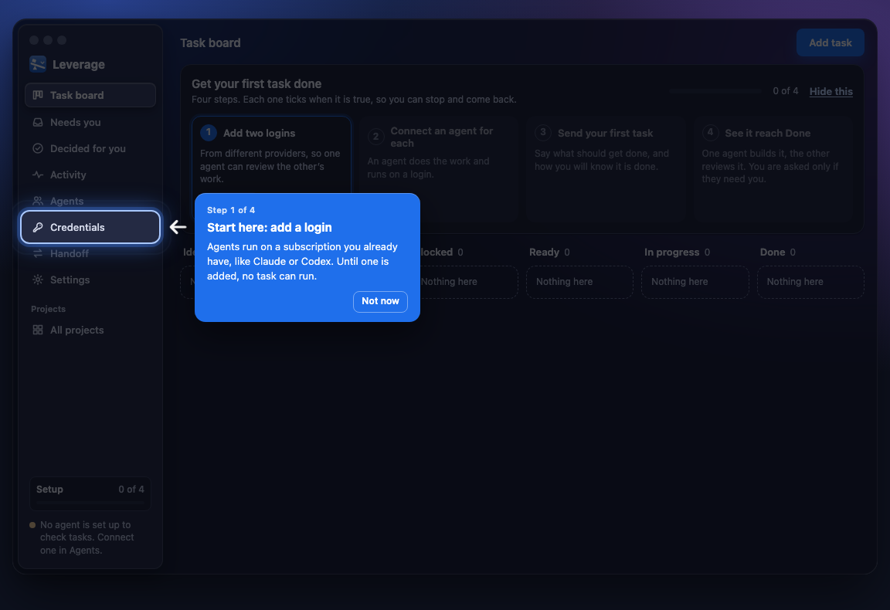

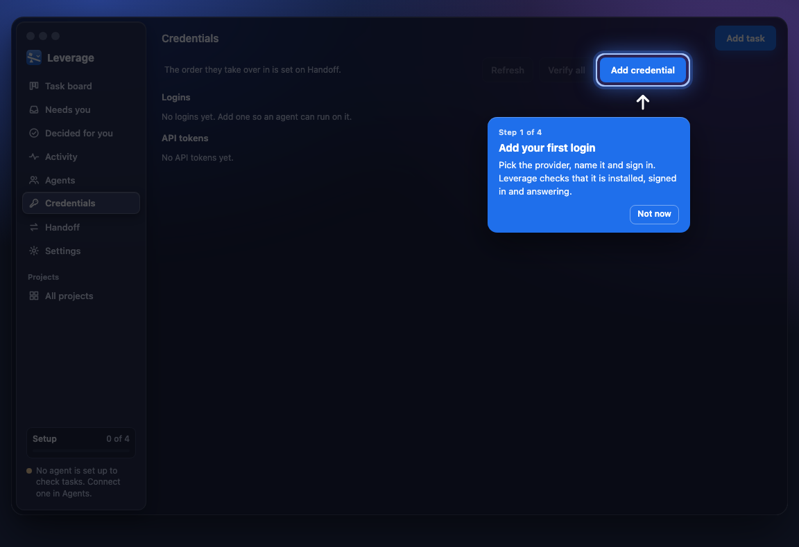

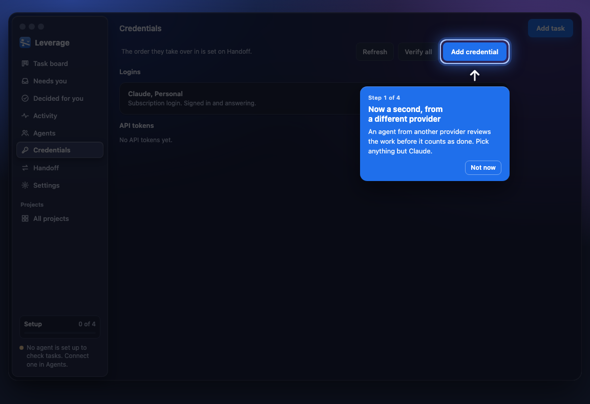

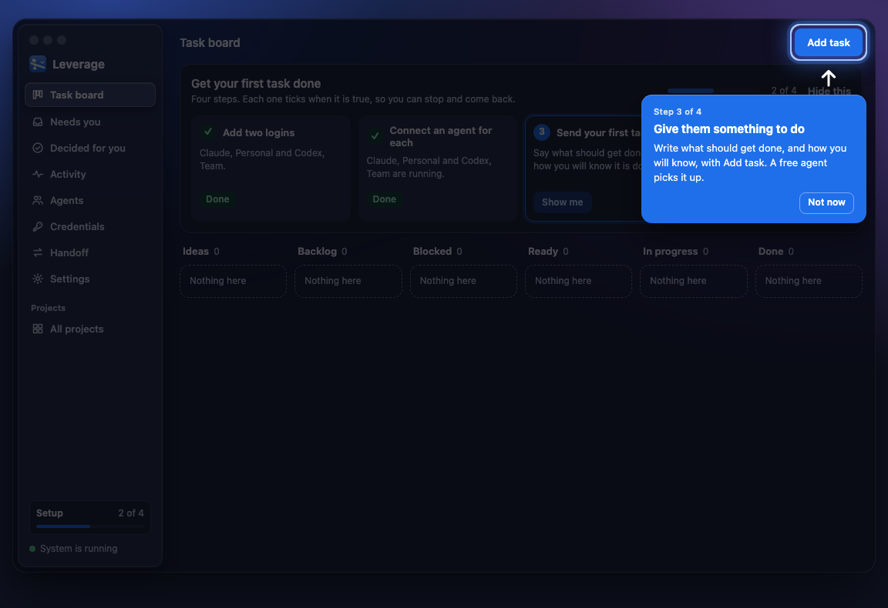

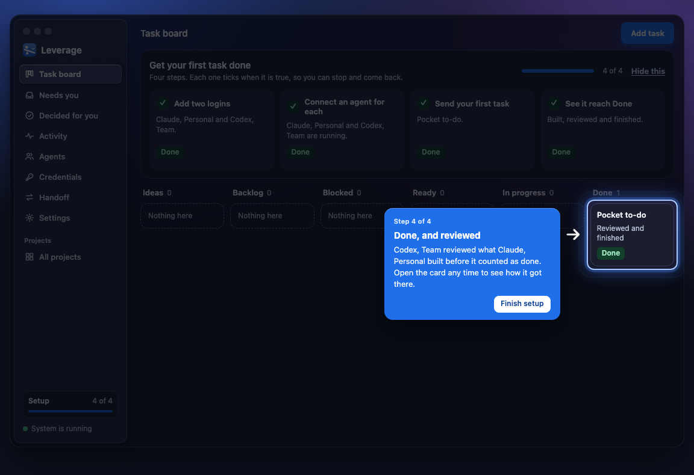

### Two helps inside existing sheets

| ID | Requirement |
| --- | --- |
| OB-40 | While the checklist shows and exactly one provider has a login, Add credential's first step says to pick a different provider from that one, so that one agent can review the other's work. |
| OB-41 | While the checklist shows, Connect agent opens with the next login that has no agent picked, and that login's name as the agent's name. |

## The Task board name

| ID | Requirement |
| --- | --- |
| OB-50 | The first tab, which the PRD calls Kanban, is labelled "Task board" in the side pane and as the screen's title, and the app's sentences say "task board". |

## Not in this version

- Ready-made tasks from a gallery. The three starter tasks are built in.
  When a gallery is in the app, the assistant's last screen and the
  checklist's third step can point at it.
- Opening the assistant again once it was left. The checklist covers the
  same steps.
- A recommended pair of providers. The assistant says that Gemini does not
  review yet and asks for two different providers; it does not rank them.
- Videos.
