# Subscription

Status: Proposed, for the maintainer's review (24 November 2026)

The owner pays for Leverage with a monthly subscription that includes
support. A row at the foot of the left pane opens one menu for the
subscription, the settings and signing out. It stays quiet while everything
is paid and says so plainly when a payment needs the owner. Payment goes
through Stripe, with Apple Pay, Link or a card.

This file is a proposal. Requirement IDs use the prefix `SB-` so they cannot
be mistaken for accepted `FR-` and `NFR-` requirements. When the maintainer
accepts the proposal, its requirements move into [docs/PRD.md](../PRD.md)
with `FR-` IDs, and this file keeps only the design reference, so that each
requirement has one home.

## Design reference

[`mockups.html`](mockups.html) is a self-contained page with every screen
below, in light and dark (the Dark button at the top). It loads nothing from
the network, and its buttons jump between screens. As with
[the main mockup](../design/README.md), the tokens and layout carry over to
the SwiftUI app; the HTML and CSS do not. The prices are decided. Text in
square brackets, such as `[DATE]` or `[What Plus includes]`, is not.

The row at the foot of the left pane, at rest:

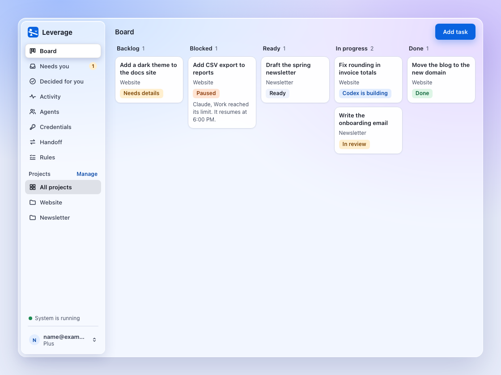

The menu, opened from that row:

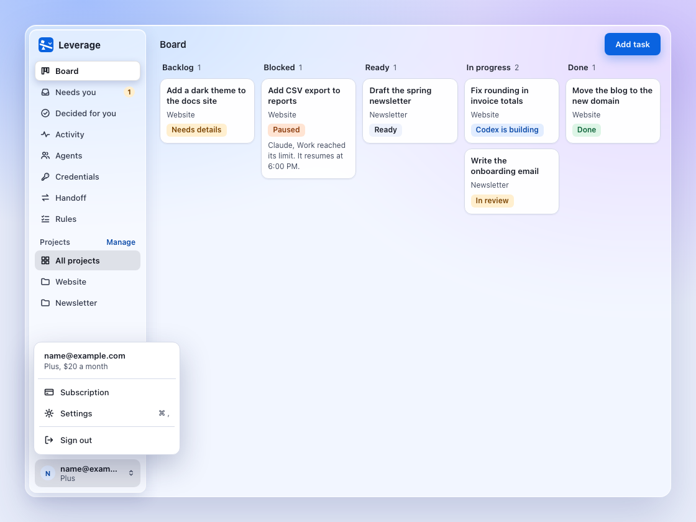

With no subscription, the Subscription page offers the three plans:

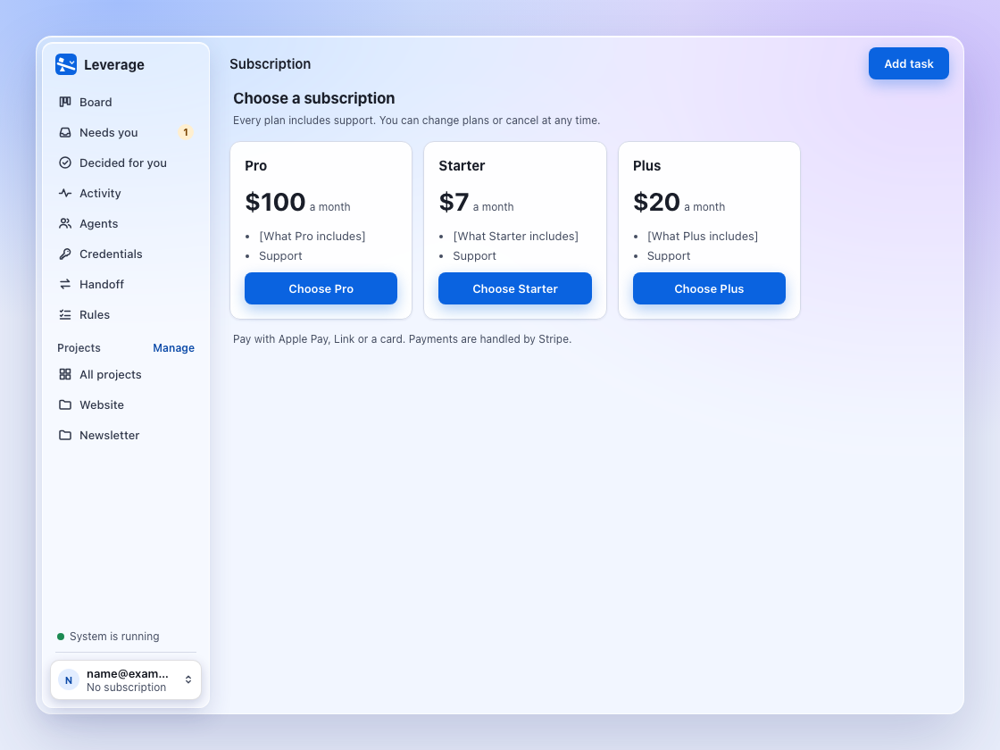

Choosing a plan says how the owner can pay before anything opens:

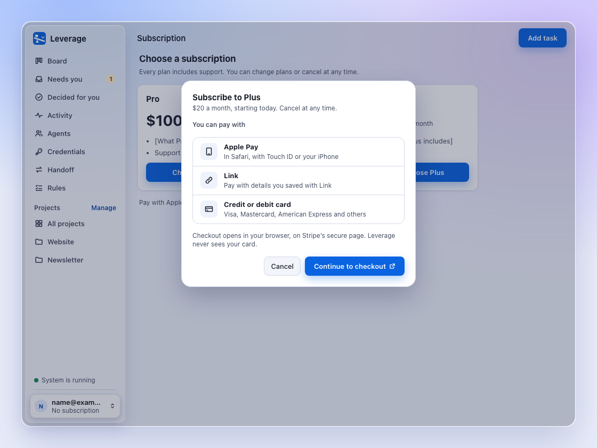

Checkout runs in the browser, and the app waits for it:

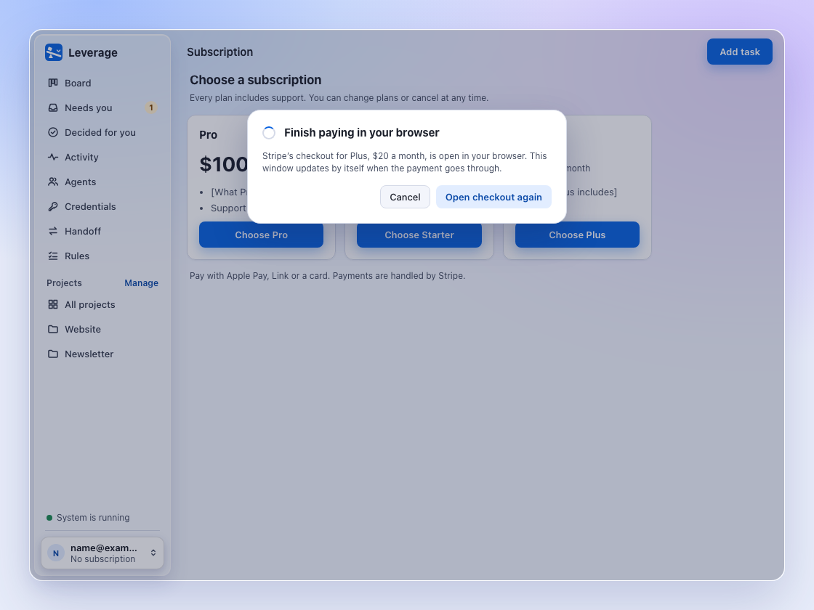

When the payment goes through:

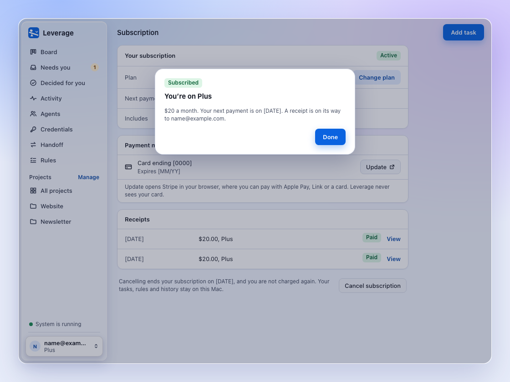

The Subscription page while the subscription is active:

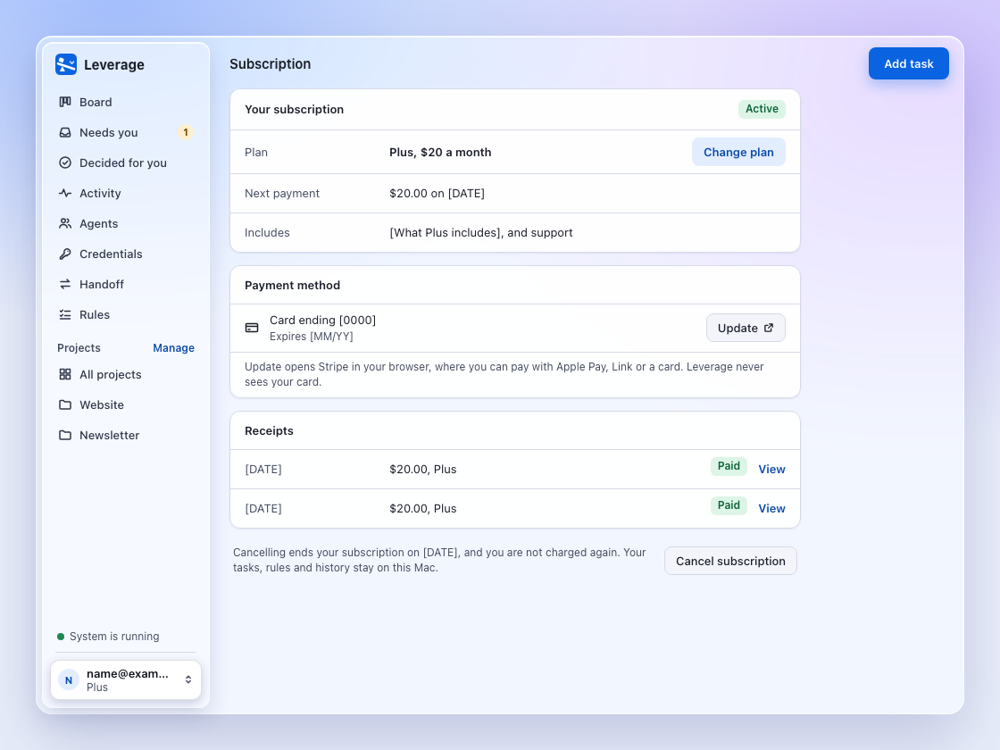

When a payment fails, the row, the page and Needs you all say so:

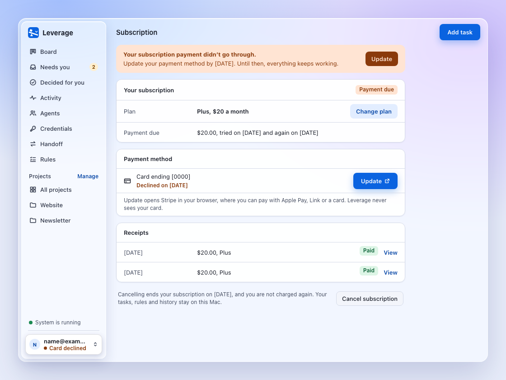

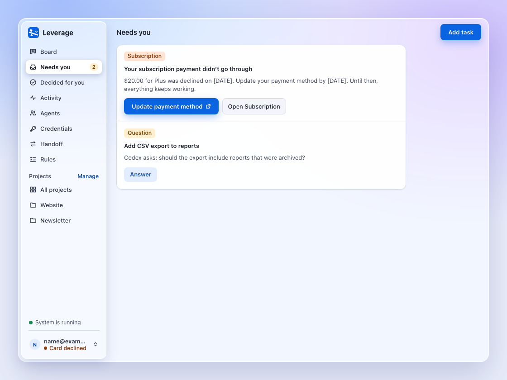

Settings, which holds the appearance only:

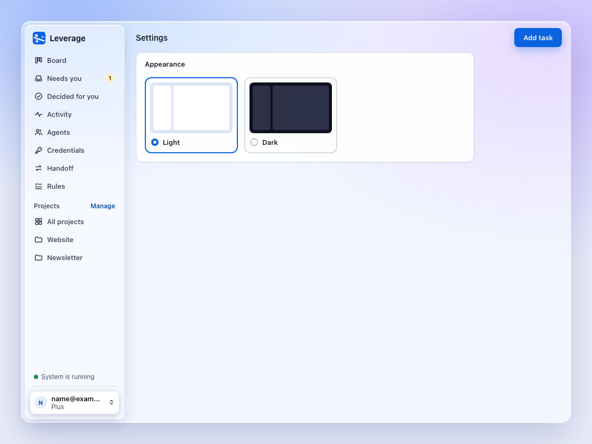

The left pane today and as proposed:

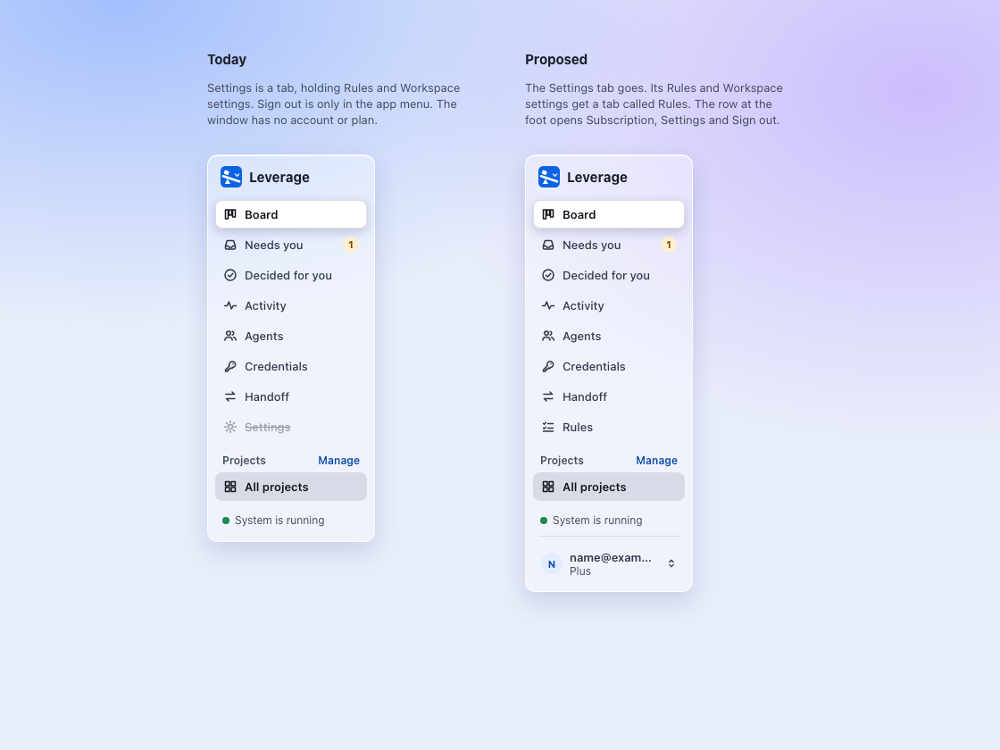

## Why

Leverage is a subscription service with support. Today the window has no
place for the owner's own account: Sign out is only in the app menu, and
there is nowhere to pay. The subscription has to be easy to find when it
needs the owner and out of the way when it does not. So it lives at the
foot of the left pane, opens only when asked, and reaches the owner through
the paths the app already uses for "this needs you".

## Decided by the owner on 2026-11-24

- The menu sits at the foot of the left pane, below the system health line,
  and opens upward.
- It holds Subscription, Settings and Sign out.
- Leverage is sold as a subscription with support. "Subscription" is the
  word for it.
- There are three plans, shown in this order: $100, $7 and $20 a month.
  What each includes is described later.
- Payment goes through Stripe. Version 1 accepts Apple Pay, Link and credit
  or debit cards. PayPal and Cash App Pay may come later.
- Settings holds one setting for now: light or dark appearance.
- The Settings tab of the left pane goes. Its contents, and later Skills,
  Roles and Analytics, live under a tab called Rules.

## Out of scope for version 1

- PayPal and Cash App Pay.
- Yearly prices, trials, discounts and coupons.
- More than one person per subscription. Leverage has one owner per
  workspace.
- Selling through the Mac App Store. The app is built on the owner's Mac
  (`scripts/build_app.sh`), and App Store distribution would bring Apple's
  rules on payment.
- Entering card details inside the app.

## Part 1: the menu at the foot of the left pane

| ID | Requirement |
| --- | --- |
| SB-1 | The left pane ends with one row below the system health line, separated from it by a thin line. It shows an initial, the owner's sign-in email, and a second line: the plan's name, "No subscription", or "Card declined" in the stop colour when a payment has failed. It shows no badge, upgrade prompt or offer. |
| SB-2 | Clicking the row opens a menu above it. The menu's header shows the email and the plan with its price. Its items are Subscription, Settings (⌘ ,) and Sign out. While the Subscription or Settings page is open, the row is drawn as selected, as a tab is. |
| SB-3 | The menu works from the keyboard: Return or Space opens it, the arrow keys move, Return chooses, and Escape closes it and returns focus to the row. VoiceOver reads the row as "Subscription, settings and sign out" with the email and the second line. |
| SB-4 | Sign out in the menu does what Sign out in the app menu does today. The app menu keeps its item. |

## Part 2: Settings and the Rules tab

| ID | Requirement |
| --- | --- |
| SB-5 | The Settings page has one section, Appearance, with two choices, Light and Dark, each shown as a small picture of the window. The choice applies at once, is kept on this Mac, and is the same after the app restarts. |
| SB-6 | The left pane's Settings tab is removed. A tab called Rules takes its place and holds the rules and the workspace settings that Settings holds today. Skills, Roles and Analytics, which [docs/PRD.md](../PRD.md) places under Settings later, go under Rules instead. |
| SB-7 | [docs/PRD.md](../PRD.md) says "Rules" wherever it means that tab: in "What the app shows in version 1", in the rule record and the hooks text, and in the data model's `workspaces` row. |

## Part 3: choosing a plan and paying

| ID | Requirement |
| --- | --- |
| SB-8 | With no subscription, the Subscription page shows three plans side by side, in this order: Pro at $100, Starter at $7 and Plus at $20 a month, in US dollars. Each card shows its name, its price, what it includes, Support, and a Choose button. Under the cards one line says the owner can pay with Apple Pay, Link or a card, through Stripe. |
| SB-9 | Choose opens a sheet naming the plan and its price, "starting today", and the three ways to pay: Apple Pay ("In Safari, with Touch ID or your iPhone"), Link, and a credit or debit card. One line says that checkout opens in the browser on Stripe's secure page and that Leverage never sees the card. The sheet has Cancel and Continue to checkout. |
| SB-10 | Continue to checkout opens Stripe Checkout for that plan in the owner's default browser, as a monthly subscription, with Apple Pay, Link and cards turned on. Apple Pay is offered only where Stripe and the browser support it, which on a Mac means Safari. |
| SB-11 | While checkout is open, the app shows "Finish paying in your browser" with Open checkout again and Cancel. It changes by itself when the payment goes through, to "You're on [plan]" with the next payment date. Cancel closes the sheet and charges nothing. |
| SB-12 | Choosing twice, or pressing Continue to checkout twice, never starts two subscriptions. |

## Part 4: the Subscription page

| ID | Requirement |
| --- | --- |
| SB-13 | While a subscription is active, the page shows: the plan and its price, with Change plan; the next payment's amount and date; what the plan includes; the payment method (Apple Pay, Link, or the card's brand, last four digits and expiry date) with Update; the receipts, newest first, each with its date, amount, plan, "Paid" and View; and Cancel subscription. |
| SB-14 | Update opens Stripe's own page for changing the payment method in the browser, where Apple Pay, Link and cards are offered as at checkout. View opens Stripe's receipt. |
| SB-15 | Change plan shows the three plans with the current one marked "Your plan". Choosing another changes the subscription. |
| SB-16 | Cancel subscription asks once, saying the date the subscription ends, that no further payment is taken, and that the owner's tasks, rules and history stay on this Mac. Confirming cancels at the end of the paid period. Leverage shows no offer to stay. |
| SB-17 | The app never receives, stores or logs a card number or security code. It knows only what Stripe reports about a payment method: its kind, and for a card its brand, last four digits and expiry date. |

## Part 5: when a payment fails

| ID | Requirement |
| --- | --- |
| SB-18 | When Stripe reports a failed subscription payment, three things change and nothing else does. The row's second line reads "Card declined". The Subscription page shows a banner: "Your subscription payment didn't go through. Update your payment method by [DATE]. Until then, everything keeps working." Needs you gets one item. |
| SB-19 | The Needs you item has the chip "Subscription", the heading "Your subscription payment didn't go through", the amount, the plan and the date it was declined, and two buttons: Update payment method, which opens Stripe's page, and Open Subscription. It is a new kind in `api/contract/needs_you.json`, and the macOS notification of every Needs you item applies to it. |
| SB-20 | The item, the banner and the row's line clear by themselves when Stripe reports the payment made. |
| SB-21 | A failed payment never stops a run that has started, and never moves a task. |

## Part 6: the subscription service

The Leverage server runs on the owner's Mac. Stripe needs a secret key, and
it sends subscription events to an address on the internet, and neither of
those can live on the owner's Mac. So a subscription needs one small service
run by the maintainer.

| ID | Requirement |
| --- | --- |
| SB-22 | A subscription service, run by the maintainer, holds the Stripe secret key, creates the Checkout and payment-method sessions, receives Stripe's events, and answers the app's question "what is this owner's subscription?". The secret key is never on the owner's Mac or in this repository. |
| SB-23 | The app knows the owner to the service by the sign-in email and an id the service issues. Stripe receives the email to send receipts. The service stores no task, project, rule, credential or event of the owner's. |
| SB-24 | On the owner's Mac, the subscription's state (no subscription, active, payment due, cancelled at a date), the plan, the next payment date and the payment method summary of SB-17 are kept outside the event log. No event payload carries any of them, since payloads hold references, not content. |
| SB-25 | The service is a new external service under rule AR-004, and how the app reaches it is a new ADR. Both are written before any of Parts 3 to 5 is built. |

## Part 7: words

These were checked on 2026-11-24 against the app's owner-facing copy
(`mac/Sources/LeverageApp/**/*Copy.swift`), [docs/PRD.md](../PRD.md), the
contract, the API and the design mockup. "Owner sees" means the word appears
on a screen.

| Word | Used today | Means there | Owner sees | Overlap | Change |
| --- | --- | --- | --- | --- | --- |
| Subscription | "Subscription login", the kind line of each login row on Credentials (`CredentialsCopy.swift`); the design mockup; [docs/PRD.md](../PRD.md) lines 11, 61, 581, 585, 740, 971, 996 | The owner's own subscription with a provider, used through that provider's tool | Yes, on login rows only | Small | Leverage's is "Subscription". The row's kind line becomes "Login", and those PRD lines say "login"; the contract's kind is already `login` |
| Subscription | `EventFeed.Subscription`; the provider's `subscriptionType`, which the helper reads | A listener on the event feed; the provider's plan field | No | None | None |
| Plan | The provider's plan, shown as a value with no label on a Credentials row; [docs/PRD.md](../PRD.md) lines 224, 628, 749, 781; `credentials.plan` in the database and the API | The provider's plan for a login | The value only | None on screen | Those PRD lines say "the provider's plan". Leverage's are "plans", or "subscription plans" where both could be meant. The field name stays |
| Plan | `docs/IMPLEMENTATION.md` and code comments | A milestone's build plan | No | None | None |
| Account | About 45 owner-facing strings, on board cards, the task log, Handoff, Agents, Needs you and Credentials; [docs/PRD.md](../PRD.md) on 56 lines | One credential as the owner reads it, such as "Claude, Personal" | Yes | Direct | Leverage's page is "Subscription", never "Account" |
| Pay, Paying | The outward action Pay in Add task, the task page, Needs you and Decided for you | An agent paying someone | Yes | Yes, in Needs you | Leverage's own items always say "subscription" (SB-19) |
| Settings | The Settings tab | Rules and the workspace's limits | Yes | Moves | "Settings" is the menu's page for appearance; the tab is "Rules" (SB-6, SB-7) |
| Billing, Receipt, Invoice | No screen | Nothing | No | None | "Receipts" on the Subscription page |

| ID | Requirement |
| --- | --- |
| SB-26 | The Terms table of [docs/PRD.md](../PRD.md) gains **Subscription**: the owner's paid monthly subscription to Leverage, which includes support; and **Plan**: one of the subscription's prices and what it includes. |
| SB-27 | The word changes in the table above are made in [docs/PRD.md](../PRD.md), the app's copy and the design mockup in the same pull request that adds Part 1. |

## Done when

1. The row, the menu, Settings with Light and Dark, and the Rules tab work
   with no subscription service at all (Parts 1 and 2).
2. With Stripe in test mode, an owner with no subscription chooses Plus,
   pays in the browser with Stripe's test card, and the app shows "You're on
   Plus" without being restarted (SB-8 to SB-12).
3. With Stripe's test card that fails on renewal, the row, the banner and
   one Needs you item appear, a run in progress goes on, and all three clear
   when the card is updated (SB-18 to SB-21).
4. A search of the repository, the logs and the event log after those runs
   finds no card number, security code or Stripe secret key (SB-17, SB-22).

## Build order

1. The word changes (SB-26, SB-27), the Rules tab (SB-6, SB-7) and Settings
   with Light and Dark (SB-5).
2. The row and the menu with Sign out (SB-1 to SB-4). Until Part 6 exists,
   the row's second line is left out.
3. The ADR and the service (Part 6).
4. Choosing and paying (Part 3), then the Subscription page (Part 4), then
   failed payments (Part 5).

## Open questions

- **The plans' names and contents.** The mockups use Pro, Starter and Plus.
  What each includes is for the owner to describe.
- **Using Leverage with no subscription.** Can the owner use the app at all
  without one, and for how long? The mockups assume the app works and the
  row says "No subscription".
- **How long a failed payment may stay unpaid,** and what stops at that date.
- **Changing plans in the middle of a month:** charge the difference at once,
  or from the next payment?
- **Support.** [MAINTENANCE.md](../../MAINTENANCE.md) says no support is
  owed under the MIT License. It needs a line on what a subscriber's support
  is and how to reach it.
- **The service's host, its privacy notice, and sales tax.** Stripe Tax can
  work out tax, at a fee.
- **Following the Mac's appearance.** Today the app follows the Mac's light
  or dark setting. With only Light and Dark, an owner loses that. Should
  there be a third choice, "Same as this Mac", as the default?
- **Stripe's details,** to confirm against Stripe's documents when the ADR is
  written: that Link and Apple Pay work in subscription-mode Checkout, and
  that Apple Pay needs no domain set up for hosted Checkout.
