# Subscription design reference

This folder holds the mockups of the subscription and the account menu,
which are the design reference for the requirements in
[Subscription](../PRD.md#subscription) in the PRD.

The maintainer accepted the proposal on 24 November 2026. Its requirements
now live only in [docs/PRD.md](../PRD.md), with `FR-` IDs.

## Interactive preview

Open [the subscription preview](preview/index.html) in a browser. It works
offline with sample data and does not ask for an account or payment details.
Reset preview returns to the plan list and clears the session.

1. Choose Pro, Starter or Plus. Continue to checkout, then open the
   simulated Stripe page. Try a sample payment, a decline, or cancellation.
2. On an active subscription, view a sample receipt, update the payment
   method, and try an immediate or scheduled change in Change plan.
3. Simulate a failed renewal. Check the account row, the Subscription
   banner, and the single Needs you item. The sample task stays in progress.
   Save a sample payment method and simulate a successful retry to clear the
   failure and see a new receipt.
4. Cancel from an active subscription to see the end date and the retained
   receipts. Use Appearance to check the same flow in Light and Dark.

Dates and plan-change timings are preview examples. Plan inclusions and
support details are marked pending. The preview keeps all state in memory.
The [billing handoff](billing-handoff.md) covers the Stripe setup, service
boundary, owner decisions and sandbox acceptance checks.

Run the mock model tests from the repository root with
`node --test docs/subscription/preview/mock-billing.test.cjs`. CI runs the
same command on every pull request.

## The mockups

[`mockups.html`](mockups.html) is a self-contained page with every screen
below, in light and dark (the Dark button at the top). It loads nothing from
the network, and its buttons jump between screens. As with
[the main mockup](../design/README.md), the tokens and layout carry over to
the SwiftUI app; the HTML and CSS do not. The prices are decided. Text in
square brackets, such as `[DATE]` or `[What Plus includes]`, is not.

The row at the foot of the left pane, at rest:

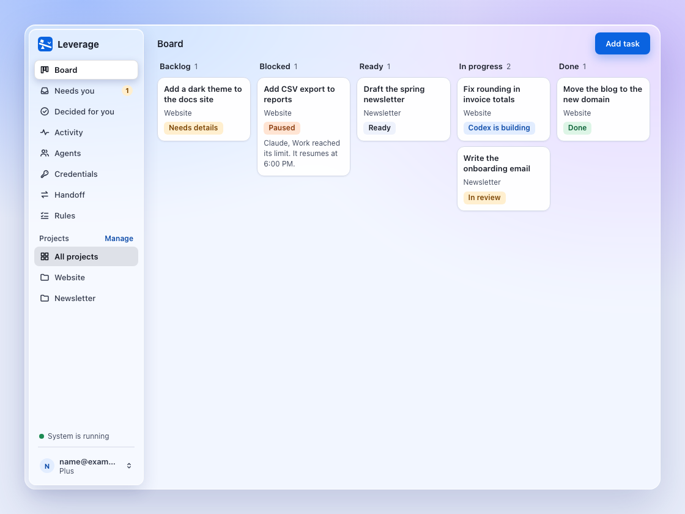

The menu, opened from that row:

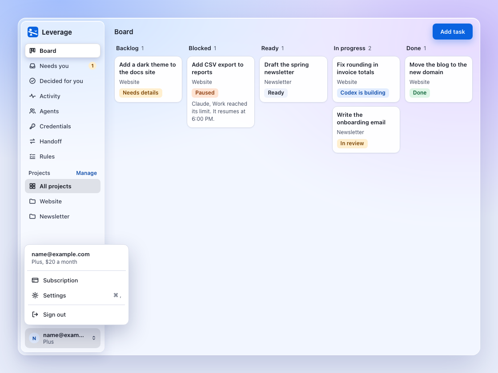

With no subscription, the Subscription page offers the three plans:

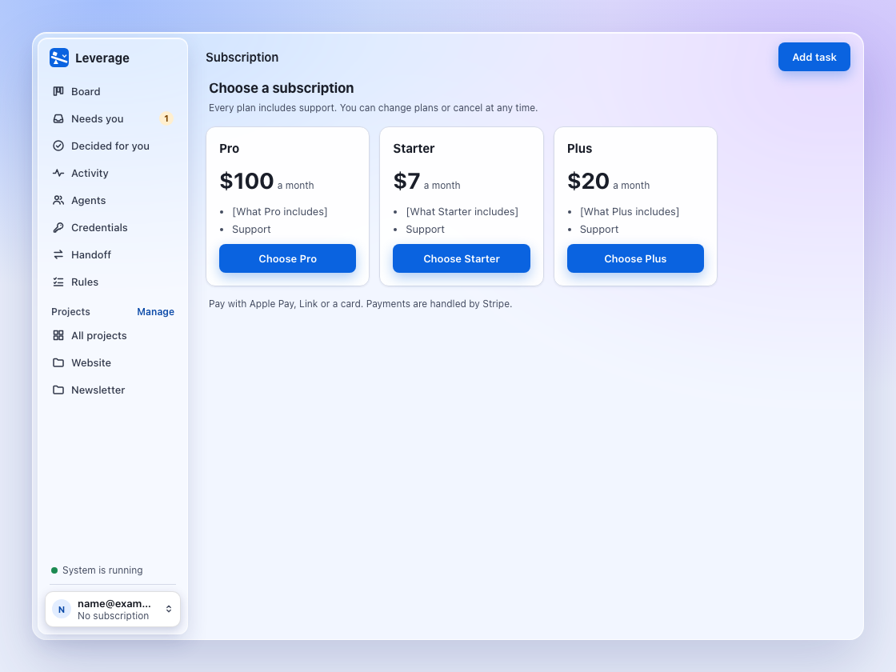

Choosing a plan says how the owner can pay before anything opens:

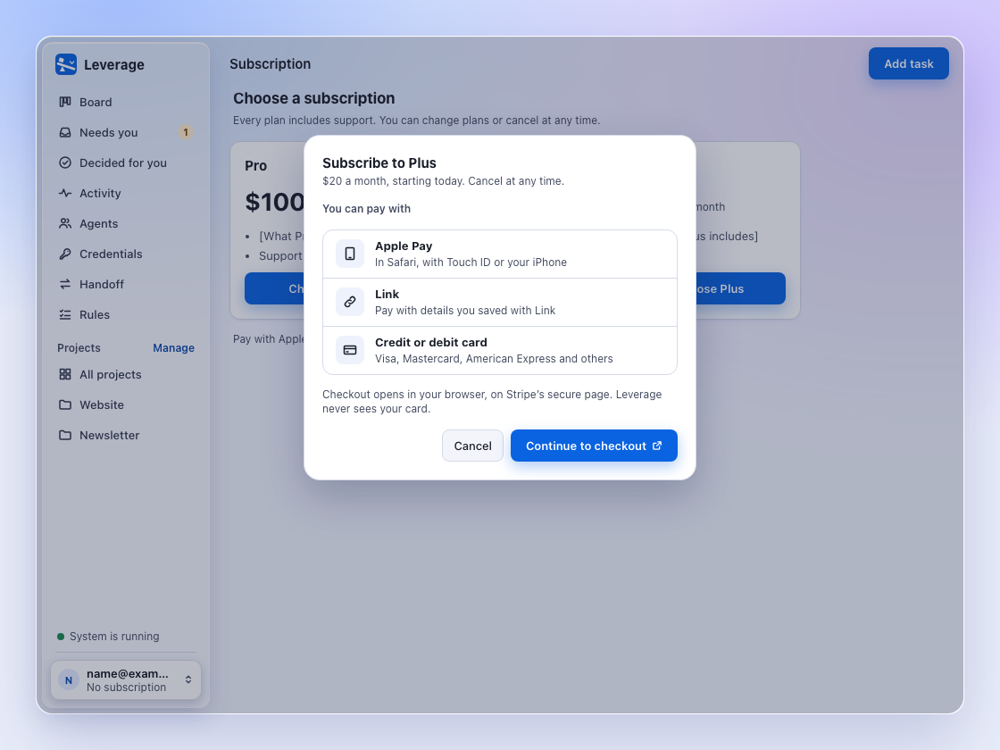

Checkout runs in the browser, and the app waits for it:

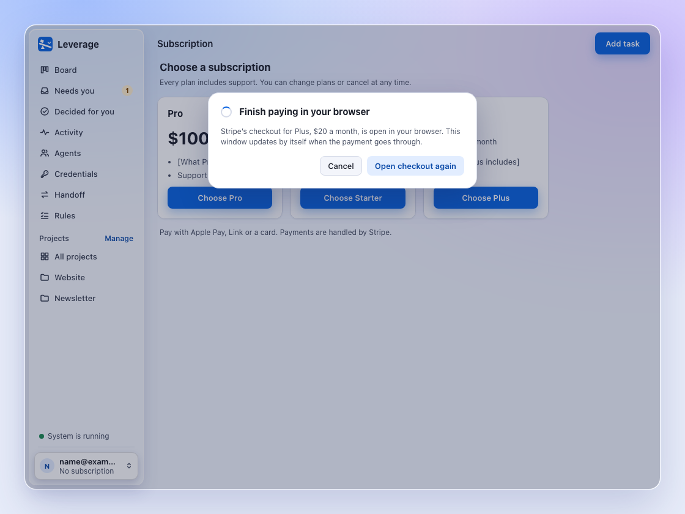

When the payment goes through:

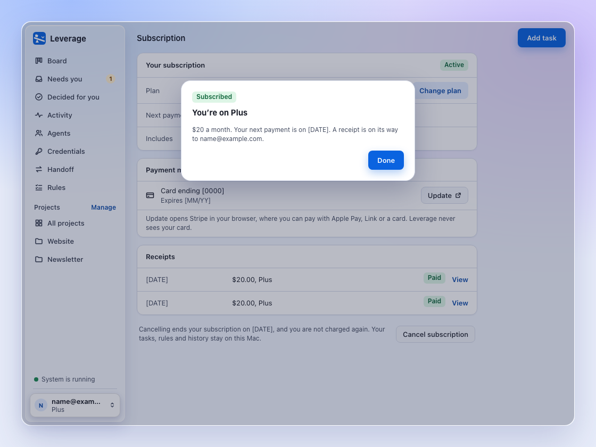

The Subscription page while the subscription is active:

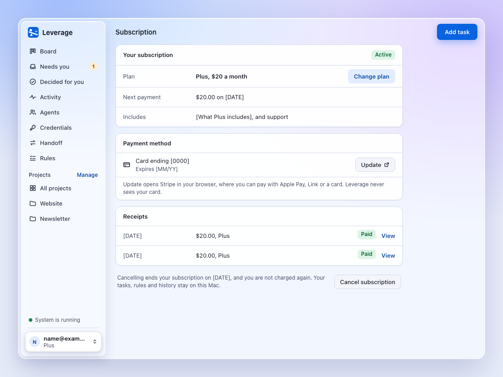

When a payment fails, the row, the page and Needs you all say so:

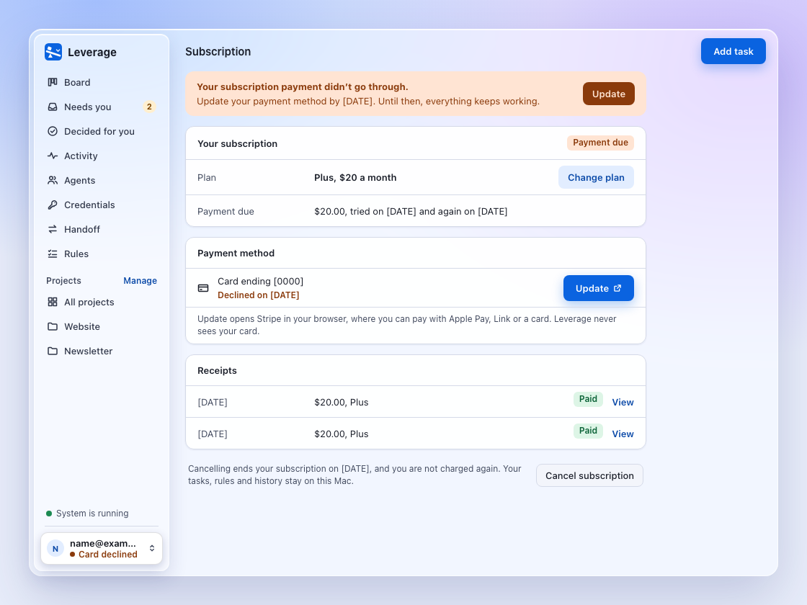

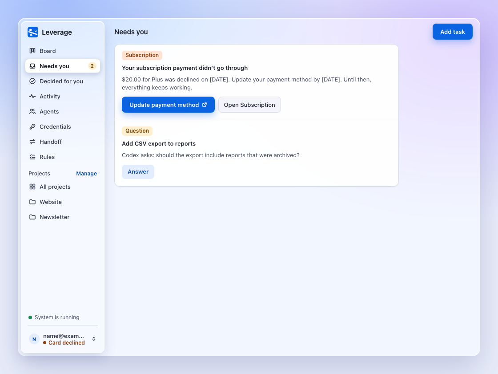

The original appearance mockup shows the two fixed themes. The approved
settings also offer Same as this Mac as the default.

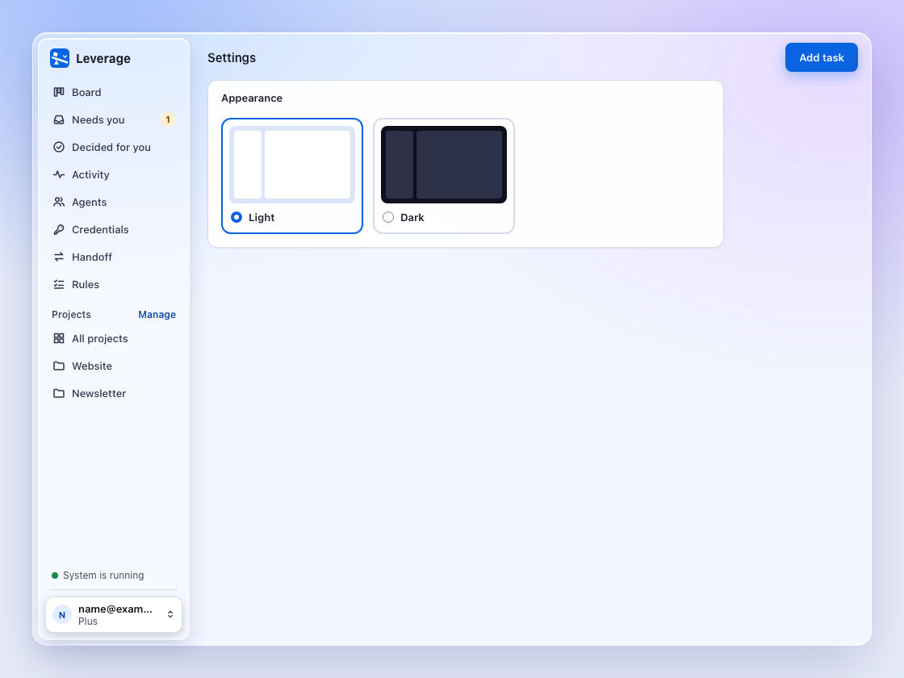

The left pane before the change and after it:

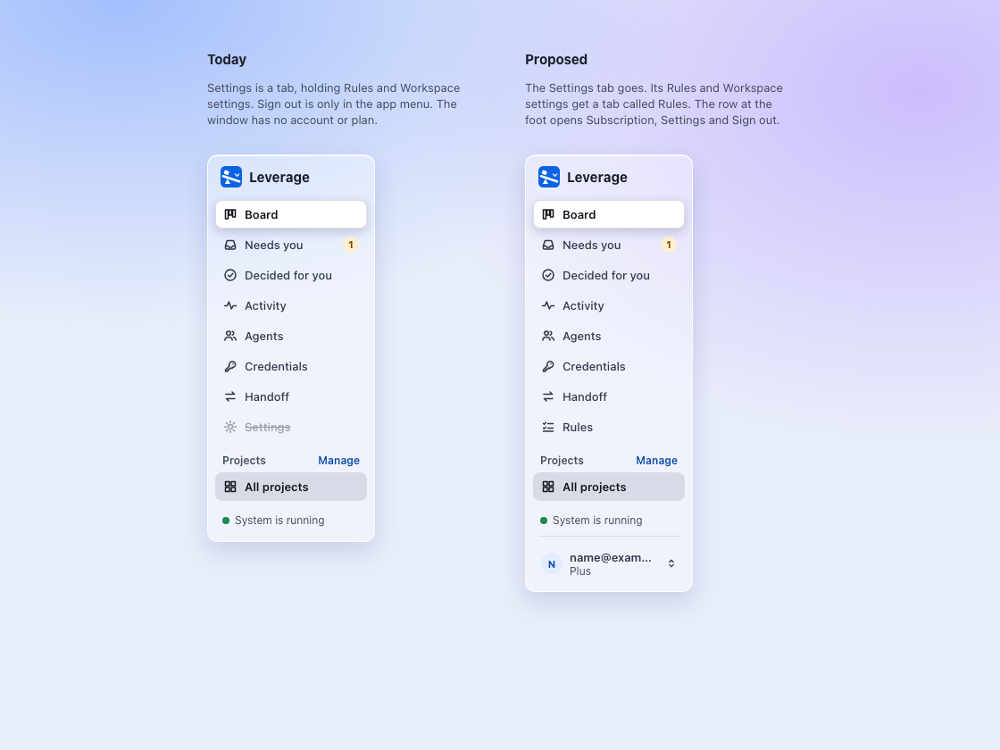

## From the proposal's IDs

The proposal used `SB-` IDs. Each one maps to an `FR-` ID, or to the PRD
change that settled it when the proposal was accepted.

| Proposal | Now |
| --- | --- |
| SB-1 to SB-6 | FR-001 to FR-006 |
| SB-7 | Done on acceptance: the PRD says "Rules" for the tab |
| SB-8 to SB-25 | FR-007 to FR-024 |
| SB-26 | Done on acceptance: Subscription and Plan are in the Terms table |
| SB-27 | The PRD's words changed on acceptance; the app's copy and the mockup are FR-025 |
